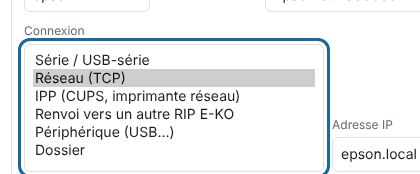

The server talks to machines over the network, over USB or through a folder. This article helps you choose the connection and check it.

## Before you start

You are an administrator and the machine is being added (see [Add a machine](rip-ajouter-une-machine.md)). For the checks, you have a terminal on the server.

## Steps

1. Choose the connection according to the machine:
   - **Network (TCP)** (*Réseau (TCP)*): Epson (direct driver, port 9100), Graphtec, Roland;
   - **Serial / USB-serial** (*Série / USB-série*): Kona or a cutter on USB-serial (port `/dev/kona`);
   - **Device (USB…)** (*Périphérique (USB…)*): machine on USB printer class (path `/dev/usb/lp0`…);
   - **Folder** (*Dossier*): third-party software that watches a folder;
   - **IPP**: **raw** CUPS queue or IPP printer;
   - **Forwarding to another E-KO RIP** (*Renvoi vers un autre RIP E-KO*): machine connected to another E-KO RIP Center server.

   

2. Fill in the **IP address** and **TCP port**, or the path, in the machine page.
3. For a machine on the network, check that it responds from the server: `nc -vz <machine-address> <port>`.
4. For a USB port, check that it exists: `ls -l <port>`.
5. For IPP, first create a **raw** queue in CUPS (`lpadmin -p epson -v socket://<printer-address>:9100 -E`), then enter the path `/printers/epson` and port 631. Check with `lpstat -h <host> -p`.
6. For forwarding, create the token on the receiving server: `sudo -u eko-rip env EKO_RIP_DATA=/var/lib/eko-rip eko-rip-serveur renvoi jeton`. Paste it into the **Forwarding** machine (*Renvoi*) on the sending server (port 8640).

## Good to know

- The forwarding token is shown only once. `renvoi etat` tells you whether it is open, and `renvoi retirer` closes the forwarding.
- The forwarding stream travels unencrypted on the local network: keep it between workshop servers.
- With a **Folder** connection, nothing is printed: the files are dropped in `sorties/<machine>/`.
- A stopped or missing CUPS queue makes the output fail, with the IPP refusal shown in plain text.

## See also

- [Add a machine to the RIP](rip-ajouter-une-machine.md)
- [Fix a failed output to the machine](../rip-depannage/rip-sortie-vers-la-machine-echouee.md)
- [Connect the Mutoh Kona 1650](rip-brancher-mutoh-kona-1650.md)
