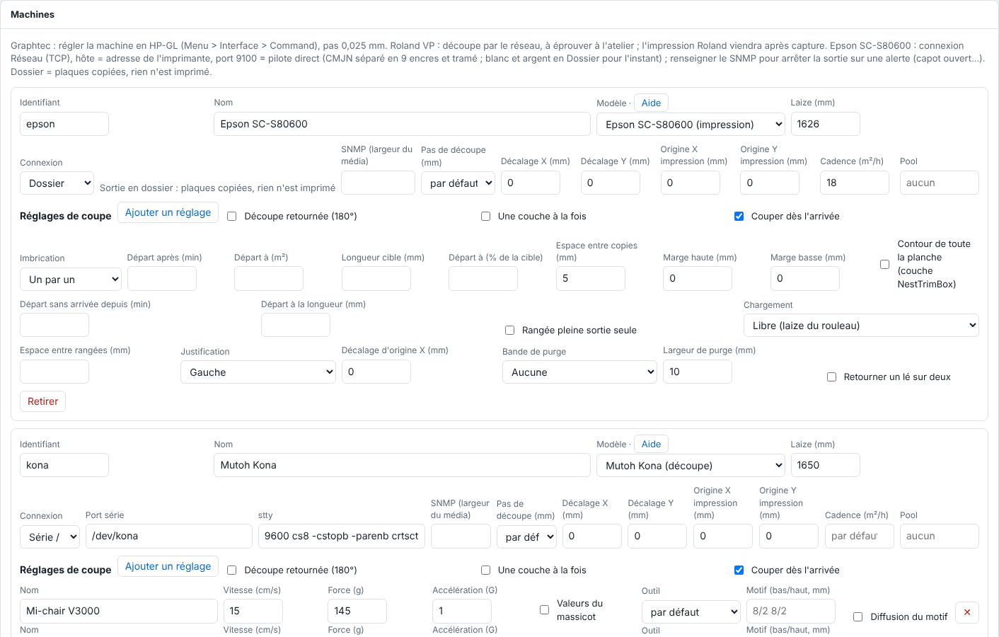

A machine's page brings together all its settings. This article describes each field, for the administrator.

## Before you start

You need an administrator account. Open **Administration…**, the **System** view (*Système*), the **Machines** section.

## Steps

1. Read the table of common fields.

   

   | Field | Purpose |
   |---|---|
   | **Identifier** (*Identifiant*) | Lowercase letters, digits, `-`. It names the `sorties/<machine>/` folder and is used for forwarding from another RIP: do not change it lightly. |
   | **Name** (*Nom*) | The displayed name. |
   | **Model** (*Modèle*) | Epson SC-S80600, Mutoh Kona, Graphtec FC7000 or Roland VersaCAMM VP. The **Help** link (*Aide*) opens the machine's page. |
   | **Roll width (mm)** (*Laize (mm)*) | The usable width. |
   | **Connection** (*Connexion*) | Serial or USB-serial, TCP network, device (such as `/dev/usb/lp0`), folder, IPP or forwarding. |
   | **SNMP (media width)** (*SNMP (largeur du média)*) | Address used to read the loaded media. |
   | **Cutting step (mm)** (*Pas de découpe (mm)*) | 0.01 mm for the Kona, 0.025 mm by default elsewhere. |
   | **X / Y offset (mm)** (*Décalage X / Y (mm)*) | From −20 to 20 mm: the gap measured on a test cut between the cut and the print, added to every cut sent to this machine. |
   | **Print origin X / Y (mm)** (*Origine X / Y impression (mm)*) | Positions the image on the page (Epson, direct driver). |
   | **Throughput (m²/h)** (*Cadence (m²/h)*) | Used to estimate durations. |
   | **Pool** | A name shared by identical machines. |

2. For a cutter, also read: its **Cut settings** (*Réglages de coupe*), **Flipped cut (180°)** (*Découpe retournée (180°)*), **One layer at a time** (*Une couche à la fois*), **Cut as soon as it arrives** (*Couper dès l'arrivée*) and **Duplicate (other set of marks)** (*Dupliquer (autre jeu de repères)*).
3. For a printer, read its **Nesting** (*Imbrication*) (see [Set up a printer's nesting](rip-regler-l-imbrication-d-une-imprimante.md)).
4. Click **Save** (*Enregistrer*): saving applies immediately; the print and cut buttons, the queue and the sidebar follow.

## Good to know

- A machine that still has an output to run cannot be removed from the catalogue.
- Identifier: lowercase letters, digits and `-` only.
- **Throughput (m²/h)**: the Epson defaults to 94 m²/h up to 360 dpi, 17 m²/h at 720 dpi (720 × 1440, 6 passes), 6.6 m²/h beyond; the value you enter replaces it (to be measured in the workshop, and for the Roland). A duration is estimated as printed length × the machine's roll width ÷ throughput.
- **Print origin X / Y**: X from the reference edge of the roll width (rounded to 16 dots), Y added to the leading margin. 0 by default, to be set using a paper test.
- A fixed IP address is recommended for any machine on the network.

## See also

- [Add a machine to the RIP](rip-ajouter-une-machine.md)
- [Choose a machine's connection](rip-choisir-la-connexion-d-une-machine.md)
- [Group printers into a pool](rip-regrouper-des-imprimantes-en-pool.md)
