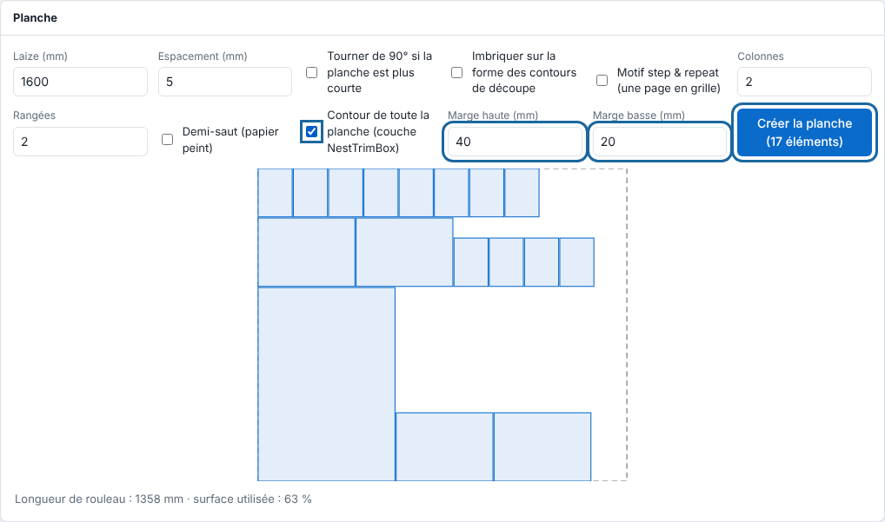

No cutting table is driven directly by the RIP yet, but it already prepares the sheets intended for them.

## Before you start

Your pages are PDFs to nest on a sheet (see [Create a sheet](../rip-travaux/rip-creer-une-planche.md)).

## Steps

1. In the **Sheet** panel (*Planche*), tick **Outline of the whole sheet (NestTrimBox layer)** (*Contour de toute la planche (couche NestTrimBox)*). A cutting rectangle is added around the placed items.
2. Set the **Top margin (mm)** (*Marge haute (mm)*) to leave white space above the items.
3. Set the **Bottom margin (mm)** (*Marge basse (mm)*) to leave white space below (0 to 200 mm for each margin).
4. Click **Create the sheet** (*Créer la planche*).

   
5. For a sheet made by queue nesting, set the same options in the **Machines** section of the **System** view (*Système*), on the printer's page: **Top margin (mm)**, **Bottom margin (mm)** and **Outline of the whole sheet (NestTrimBox layer)**.

   

## Good to know

- The outline is in its own `NestTrimBox` layer, cut last and never printed.
- No cutting table is driven directly by the RIP yet: each supported table will get its article in this family, like the printers and plotters. To request support for a table, write to [contact@e-ko.rip](mailto:contact@e-ko.rip) with the make, the model and the table's software.
- Sheet details: [Refine a sheet: shapes, repeat and global outline](../rip-travaux/rip-affiner-une-planche.md).

## See also

- [Create a sheet to group prints](../rip-travaux/rip-creer-une-planche.md)
- [Add a machine to the RIP](rip-ajouter-une-machine.md)
- [Manage a machine's queue](../rip-travaux/rip-gerer-la-file-d-une-machine.md)
