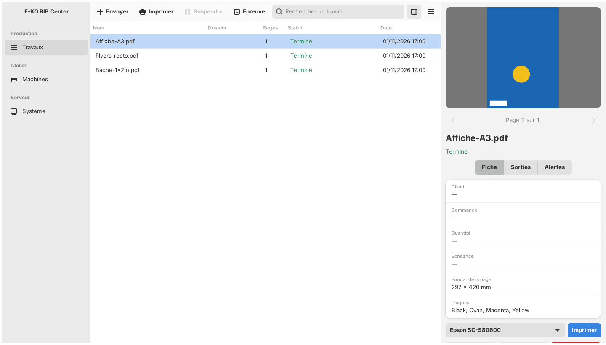
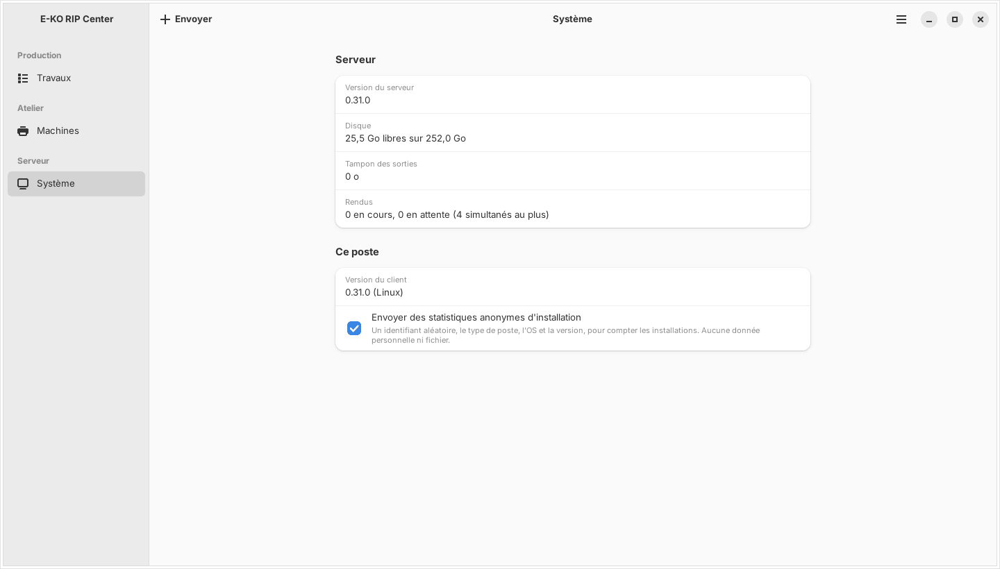

The E-KO RIP Center client is the software for the workstations: you use it to send files, follow the jobs and the queue, and start printing and cutting. This article presents its window, which is broadly the same on Mac, Linux and Windows.

## Before you start

The client is installed and connected to a server (see [Connect to the server from a workstation](rip-se-connecter-au-serveur.md)). All clients talk to the same server and see the same queue.

## Steps

1. Find the **sidebar** on the left: **Jobs** (*Travaux*), **Machines** (*Machines*) and **System** (*Système*).
2. In the centre, read the **job table**: name, folder, pages, status and date. A search box lets you filter the list.
3. Click a job: the **inspector** on the right shows the preview, the job ticket, the ink plates and the alerts.
4. Use the inspector actions: **Print** (*Imprimer*), **Retry** (*Relancer*), **TIFF proof** (*Épreuve TIFF*), **Delete** (*Supprimer*).
5. Open **Machines** to see the queue of each printer and cutter.
6. Open **System** to read the server version, the disk space, the output buffer, the renders in progress and the client version.
7. For the full settings (machines, media, colour, cutting, accounts, backup, Cloud), open **Administration…** (*Administration…*) in the menu.

## Good to know

- **Where to find the menus.** On Mac: **Server › Change server…** (*Serveur › Changer de serveur…*), **Server › Administration…** (*Serveur › Administration…*), **Server › Sign out** (*Serveur › Se déconnecter*), **Help › Report a problem…** (*Aide › Signaler un problème…*). On Linux: the ☰ button at the top right, with **Administration…**, **Report a problem…** (*Signaler un problème…*), **Change server…** (*Changer de serveur…*), **Sign out** (*Se déconnecter*) and **About E-KO RIP Center** (*À propos d'E-KO RIP Center*). On Windows: the **…** button in the toolbar, with **Refresh** (*Actualiser*, F5), **Administration…**, **Change server…**, **Sign out**, **Help / Documentation** (*Aide / Documentation*, F1) and **About E-KO RIP Center**.
- On Windows, external links in the administration window open in the default browser.
- The Windows client reuses the interface of the Mac and Linux clients. When you send a file, its default setting is **No preset** (*Sans réglage*): the server then applies its default settings.
- In the **System** view, the checkbox for sending anonymous statistics (random identifier, type of computer, system and version, with no personal data and no files) can be unticked at any time.
- Opening `http://<server-address>:8640` in a browser shows only a status page: the interface and the API are reserved for the client.

## See also

- [Send a job to the RIP](../rip-travaux/rip-envoyer-un-travail.md)
- [Follow the jobs and start printing](../rip-travaux/rip-suivre-les-travaux.md)
- [Connect to the server from a workstation](rip-se-connecter-au-serveur.md)
