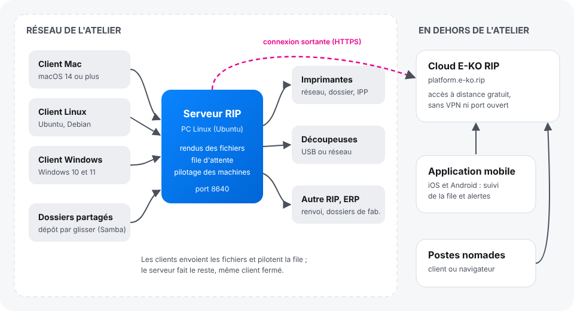

E-KO RIP Center is a free, open-source large-format print RIP. A server installed on a Linux PC in the workshop receives the files, computes the renders and drives the printers and cutters. This article presents the five parts of the RIP and what to know before you start.

## Before you start

Nothing to install to read this article. It is for anyone discovering the RIP: workshop manager, operator, administrator.

## Steps

1. Find the five parts in the table below and the diagram that follows.

   | Part | Where | Role |
   |---|---|---|
   | **RIP server** | a Linux PC in the workshop, always on | receives the files, computes the renders, keeps the queue, drives the machines |
   | **E-KO RIP Center client** | each workstation (Mac, Linux, Windows) | sends the files, follows the jobs, starts printing and cutting |
   | **Mobile app** | iOS or Android phone | follows the queue and the machines, receives alerts (empty cartridge, machine unreachable…) |
   | **E-KO RIP Cloud** | online service, `platform.e-ko.rip` | gives access to the server from outside, with no VPN and no open port |
   | **Administration interface** | in the client (**Administration…**) or through the Cloud in a browser | settings for machines, media, colour, accounts, backup |

   
2. Remember that all the work is done on the server. The clients send the files and display the queue: once a file is sent, you can close the client, and the render and the printing carry on.
3. Remember that a single server serves the whole workshop. All workstations, Mac, Linux or Windows, see the same queue and the same machines.
4. Remember that the server stays in the workshop. It is never exposed to the Internet: to reach it from outside, use E-KO RIP Cloud, which is free.
5. Then move on to the installation, in the order described by [Set up a RIP workshop in five steps](rip-installer-un-atelier-en-cinq-etapes.md).

## Good to know

- The software is open source: the code is public under the AGPL-3.0 licence in the [public source repository](https://github.com/mvignaud/eko-rip-center). No licence to buy, no limit on the number of workstations.
- A browser opened on the server's address, inside the workshop, shows only a **status page** (version, machines, address to enter in the client): the full interface is reserved for the clients.

  
- Trade terms (plate, media width, proof, registration marks…) are explained in the [glossary](rip-consulter-le-glossaire.md).
- This help follows the latest published version; what is new in each version is in the [release notes](https://e-ko.rip/changelog/).

To find your article according to what you want to do:

| I want to… | Read |
|---|---|
| Understand the whole and set up a workshop step by step | [Set up a RIP workshop in five steps](rip-installer-un-atelier-en-cinq-etapes.md) |
| Install the server on a Linux PC | [Install the RIP server](rip-installer-le-serveur.md) |
| Install the software on my Mac, Linux PC or Windows | [Install the client on Mac](rip-installer-le-client-mac.md), [on Linux](rip-installer-le-client-linux.md), [on Windows](rip-installer-le-client-windows.md) |
| Follow production on my phone | [Install the mobile app](rip-installer-l-application-mobile.md) |
| Reach the workshop from home or from a customer's site | [Link the server to the Cloud](../rip-cloud-premiers-pas/rip-cloud-relier-un-serveur.md) |
| Send a file, print, cut, make a proof | [Send a job](../rip-travaux/rip-envoyer-un-travail.md) |
| Connect and set up a machine | [Add a machine](../rip-machines/rip-ajouter-une-machine.md) |
| Manage accounts, back up, update | [Create the server accounts](../rip-administration/rip-creer-les-comptes.md) |
| Understand an error message | [The client cannot find the server](../rip-depannage/rip-client-ne-trouve-pas-le-serveur.md) and the other articles in the Troubleshooting section |

## See also

- [Set up a RIP workshop in five steps](rip-installer-un-atelier-en-cinq-etapes.md)
- [Choose the server computer](rip-choisir-le-poste-serveur.md)
- [Look up the RIP glossary](rip-consulter-le-glossaire.md)
- [Report a problem to the team](../rip-depannage/rip-signaler-un-probleme.md)
