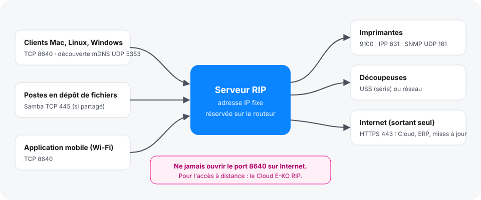

The server listens on a single port for the clients and reaches a few others towards the machines and the Internet. This article lists these ports for the person who sets up the router or firewall.

## Before you start

You have access to the workshop's router or firewall. If the server has its own firewall, you also need administrator access to the server.

## Steps

1. Find in the diagram what the server listens on (left) and what it reaches (right).

   
2. Let the ports in the table through.

   | Direction | Port | For |
   |---|---|---|
   | Workstations → server | TCP **8640** | clients, mobile app inside the workshop, forwarding between RIPs |
   | Workstations ↔ server | UDP 5353 (mDNS) | automatic discovery of the server by the clients |
   | Workstations → server | TCP 445 | shared hot folders (Samba), if you share them |
   | Server → printers | TCP 9100, 631 (IPP), UDP 161 (SNMP) | sending jobs, ink levels, loaded media |
   | Server → Internet | TCP 443 (HTTPS, outbound) | updates, E-KO RIP Cloud, ERP |
3. Reserve a fixed IP address for the server, the network printers and the network cutters (a fixed DHCP lease on the router, or manual entry).
4. If the clients cannot find the server, check that TCP port 8640 and UDP port 5353 pass through the server's firewall.

## Good to know

> Never open port 8640 to the Internet: the connection is not encrypted (HTTP), and the server must be reachable only from the workshop network. To work remotely, use [E-KO RIP Cloud](../rip-cloud-premiers-pas/rip-cloud-acceder-a-distance.md): the server itself opens an outbound connection, so there is no port to open.

- Why a fixed address: the clients, the shared folders (Samba), another RIP receiving forwarded jobs and the ERP reach the server by its address; the Epson is reached for the direct driver (port 9100) and for SNMP reading; network cutters (Graphtec, Roland) and a CUPS server or another E-KO RIP are entered by their address in **System › Machines** (*Système › Machines*).
- Prefer a cable to Wi-Fi between the server and the machines.
- Automatic discovery (mDNS) crosses neither routers, nor VPNs, nor some guest Wi-Fi networks: enter the address in the client instead. To avoid announcing itself on the network at all, see `EKO_RIP_ANNONCE` in [Change the server's advanced settings](../rip-administration/rip-modifier-les-reglages-avances-du-serveur.md).
- The ERP and the package repository are reached over outbound HTTPS: nothing to open on the inbound side.

## See also

- [The client cannot find the server](../rip-depannage/rip-client-ne-trouve-pas-le-serveur.md)
- [Choose the server computer](rip-choisir-le-poste-serveur.md)
- [Choose how a machine connects](../rip-machines/rip-choisir-la-connexion-d-une-machine.md)
- [Share the hot folders](../rip-administration/rip-partager-les-dossiers-surveilles.md)
