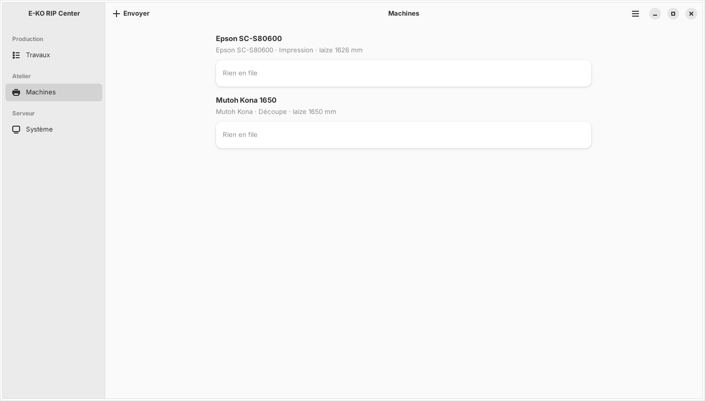

The E-KO RIP Center client is the software for the workstations: you use it to send files and follow the jobs. This article describes how to install it on Linux.

## Before you start

You need Ubuntu 24.04 or later, or Debian 13 (GNOME desktop recommended), on a 64-bit PC, with `sudo` access. Allow 5 minutes.

## Steps

1. Open a terminal.
2. Run the installation, which also adds the E-KO repository to the system:
   `wget -qO- https://apt.e-ko.fr/rip/installer | sudo sh`
3. Open the applications and start **E-KO RIP Center**.
4. Choose your server on the connection screen (see [Connect to the server](rip-se-connecter-au-serveur.md)).

## Good to know

- The script adds the repository key and an APT source file (`/etc/apt/sources.list.d/eko-rip.list`), then installs the client.
- `.deb` and `.AppImage` files are also available on the releases page, for computers with no access to the repository.
- The client is then updated along with the rest of the system: `sudo apt update && sudo apt upgrade`.
- The main menu (☰ button at the top right) gives **Administration…** (*Administration…*), **Report a problem…** (*Signaler un problème…*), **Change server…** (*Changer de serveur…*), **Sign out** (*Se déconnecter*) and **About E-KO RIP Center** (*À propos d'E-KO RIP Center*).
- One PC can be both server and workstation: the same repository serves both, then just install the `eko-rip-serveur` package.

## See also

- [Connect to the server from a workstation](rip-se-connecter-au-serveur.md)
- [Install the RIP server](rip-installer-le-serveur.md)
- [Send a job to the RIP](../rip-travaux/rip-envoyer-un-travail.md)
- [Understand the client window and its menus](rip-comprendre-la-fenetre-du-client.md)
