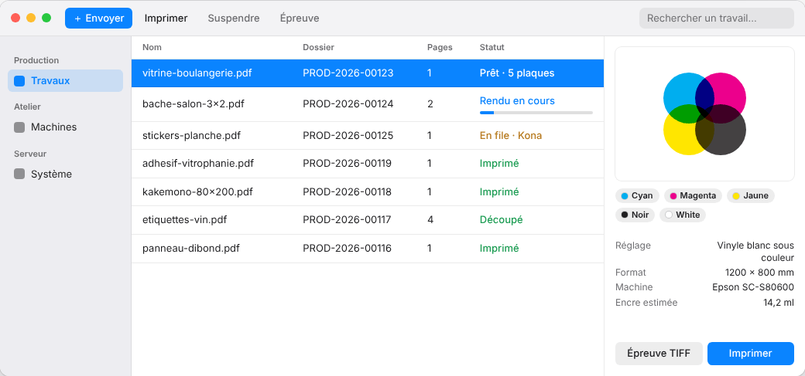

The E-KO RIP Center client is the software for the workstations: you use it to send files and follow the jobs. This article describes how to install it on a Mac.

## Before you start

You need macOS 14 (Sonoma) or later, on an Apple Silicon or Intel Mac. The server must already be running in the workshop. Allow 5 minutes.

## Steps

1. Open https://e-ko.rip/telecharger/mac and download the `.dmg` file of the latest version.
2. Open the `.dmg` file.
3. Drag **E-KO RIP Center** into **Applications**.
4. Start the application. It is signed and verified by Apple: it opens without a warning.
5. When macOS asks for access to the **local network**, accept.
6. Choose your server on the connection screen (see [Connect to the server](rip-se-connecter-au-serveur.md)).

## Good to know

- Without local network access, the client cannot find the server. You can grant it afterwards in System Settings › Privacy & Security › Local Network.
- The file to download is called `E-KO.RIP.Center_<version>_universal.dmg`: it suits both Apple Silicon and Intel Macs.
- To update, download the new version and replace the application. A client slightly older than the server keeps working.
- To work remotely, see [Connect to the cloud from the Mac or Linux client](rip-se-connecter-au-cloud-depuis-le-client.md).
- Useful menus: **Server › Change server…** (*Serveur › Changer de serveur…*), **Server › Administration…** (*Serveur › Administration…*), **Server › Sign out** (*Serveur › Se déconnecter*) and **Help › Report a problem…** (*Aide › Signaler un problème…*).

## See also

- [Connect to the server from a workstation](rip-se-connecter-au-serveur.md)
- [Send a job to the RIP](../rip-travaux/rip-envoyer-un-travail.md)
- [The client cannot find the server](../rip-depannage/rip-client-ne-trouve-pas-le-serveur.md)
- [Understand the client window and its menus](rip-comprendre-la-fenetre-du-client.md)
