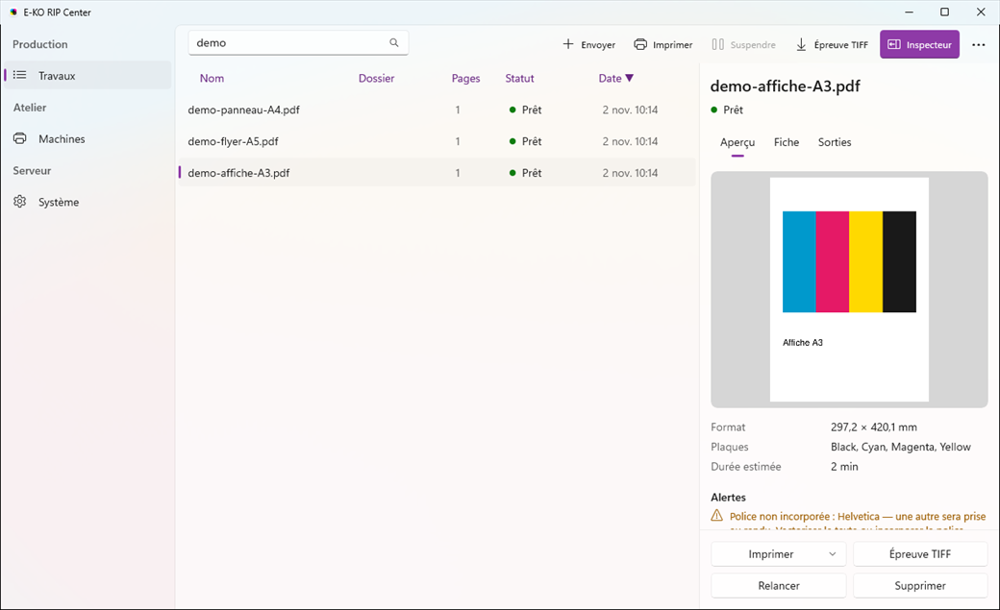

The E-KO RIP Center client is the software for the workstations: you use it to send files and follow the jobs. This article describes how to install it on Windows.

## Before you start

You need Windows 10 or 11, 64-bit. No administrator rights are needed: the client installs for the current user. Allow 5 minutes.

## Steps

1. Open https://e-ko.rip/telecharger/#windows. The page gives the version, the size and the SHA-256 fingerprint of the installer.
2. Follow the link to the release page and download the file that ends in `_x64-setup.exe`.
3. Run that file and follow the wizard.
4. If Windows shows "Windows a protégé votre ordinateur" (Windows protected your PC), click **More info** (*Informations complémentaires*), then **Run anyway** (*Exécuter quand même*).
5. Open **E-KO RIP Center** from the Start menu.
6. Enter the server address on the connection screen (see [Connect to the server](rip-se-connecter-au-serveur.md)).

## Good to know

- The installer exists as `E-KO.RIP.Center_<version>_x64-setup.exe` or as an `.msi`.
- The Windows warning appears only once per computer.
- The Windows client does not search for servers on the network yet: always enter the server address, in the form `<server-address>:8640`.
- The client reuses the interface of the Mac and Linux clients, with the Windows notification when a job is ready; see [Understand the client window and its menus](rip-comprendre-la-fenetre-du-client.md).
- To update, download and run the new installer: it replaces the old version.
- The menu (**…** button) gives **Refresh** (*Actualiser*), **Administration…** (*Administration…*), **Change server…** (*Changer de serveur…*), **Sign out** (*Se déconnecter*), **Help / Documentation** (*Aide / Documentation*) and **About E-KO RIP Center** (*À propos d'E-KO RIP Center*).

## See also

- [Connect to the server from a workstation](rip-se-connecter-au-serveur.md)
- [Send a job to the RIP](../rip-travaux/rip-envoyer-un-travail.md)
- [The client cannot find the server](../rip-depannage/rip-client-ne-trouve-pas-le-serveur.md)
- [Windows shows "Windows protected your PC"](../rip-depannage/rip-windows-protege-votre-ordinateur.md)
