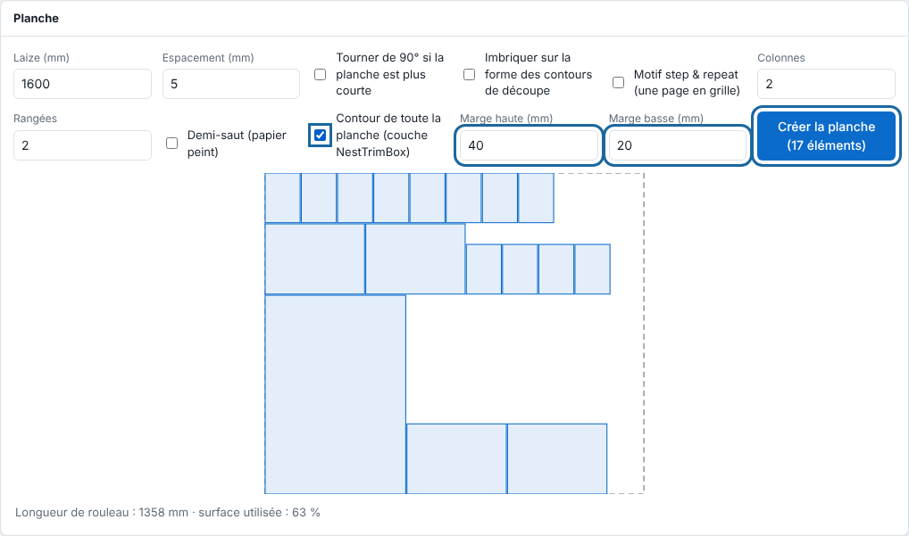

The **Sheet** (*Planche*) panel has several options to pack pieces tighter or repeat a pattern. This article builds on creating a sheet.

## Before you start

You know how to create a sheet (see [Create a sheet to group prints](rip-creer-une-planche.md)).

## Steps

1. On each printable page, tick **Add to sheet** (*Ajouter à la planche*) and enter the number of copies.
2. In the **Sheet** panel, set the **roll width** (*laize*) and the **spacing** (*espacement*). The imposition is drawn: the roll at its width, each item in place (hover to see its name and dimensions), the roll length and the share of area used.
3. To rotate items, tick **Rotate by 90° if the sheet is shorter** (*Tourner de 90° si la planche est plus courte*): four orientations are tried (as is, all rotated, all lying down, all upright) and the one with the shortest roll length is kept. An item wider than the roll only fits rotated.
4. To pack pieces tighter, tick **Nest on the shape of the cut outlines** (*Imbriquer sur la forme des contours de découpe*): each item takes the space of its cut outline, plus the spacing, instead of its rectangle (circles staggered, triangles head to tail, with angles of 0, 90, 180 and 270°).
5. To repeat a page in a grid, tick **Step & repeat pattern** (*Motif step & repeat*), set the **columns** and **rows**, and tick **Half-drop** (*Demi-saut*) to shift every other column by half a height (wallpaper match).
6. Tick **Outline of the whole sheet (NestTrimBox layer)** (*Contour de toute la planche (couche NestTrimBox)*) and set **Top margin (mm)** and **Bottom margin (mm)** (*Marge haute (mm)*, *Marge basse (mm)*; 0 to 200) if the sheet goes to a cutting table.

   
7. Click **Create the sheet** (*Créer la planche*): the sheet is a new job, with the cut of all outlines.

## Good to know

- Items are arranged from tallest to shortest, left to right. The resolution and registration of the New job panel apply.
- An item with no closed outline keeps its rectangle. The imposition then draws the outlines.
- The calculation uses a grid whose step is 1/800 of the roll width (1 mm at least): a cut never touches its neighbour, but the real gap can exceed the requested spacing by one step.
- The share of area used counts the area of the cut outlines, in both modes.
- With **Step & repeat pattern**, the ticked number of copies is ignored; the grid must fit in the roll width (100 columns, 500 rows and 2000 copies at most). The cut follows each copy.
- A page that carries cutting marks but no cut path gets an alert: ink and media for nothing.
- The overall outline is in its own `NestTrimBox` layer, cut last and never printed.

## See also

- [Create a sheet to group prints](rip-creer-une-planche.md)
- [Prepare a sheet for a cutting table](../rip-machines/rip-preparer-une-planche-pour-une-table-de-decoupe.md)
- [Build a sheet by hand or with variable data](rip-composer-une-planche-par-l-api.md)
