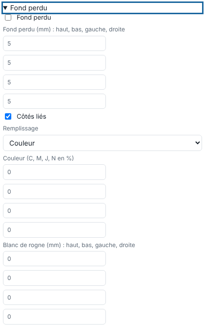

A bleed prevents a white edge when the cut is not exactly on the edge of the image. This article is for operators.

## Before you start

You are sending a file, or editing a finished job. The **Bleed** (*Fond perdu*) block is in **Quick edit** (*Édition rapide*).

## Steps

1. Open the **Bleed** block and tick **Bleed**.
2. Enter the bleed for the four sides (top, bottom, left, right), up to 100 mm. Leave **Linked sides** (*Côtés liés*) ticked to use the same value everywhere.
3. Choose the **Fill** (*Remplissage*): a **Colour** (*Couleur*; C, M, Y, K in %), the first pixel of the edge, the mirror of the image, or duplicated edges.
4. If needed, enter a **Trim white** (*Blanc de rogne*; top, bottom, left, right): white added around, beyond the bleed.

   
5. Click **Send to the RIP** (*Envoyer au RIP*).

## Good to know

- Cut spot colours are not copied into the bleed.
- Printed marks are placed outside the bleed (see [Add grommets and printed marks](rip-poser-des-oeillets-et-des-marques-imprimees.md)).
- The rectangular cut outline can be placed around the bleed or around the trim box (bleed + trim): see [Set up quick editing for a job](rip-regler-l-edition-rapide-d-un-travail.md).
- The margin grows by itself to hold the bleed.

## See also

- [Set up quick editing for a job](rip-regler-l-edition-rapide-d-un-travail.md)
- [Add grommets and printed marks](rip-poser-des-oeillets-et-des-marques-imprimees.md)
- [Send a job to the RIP](rip-envoyer-un-travail.md)
