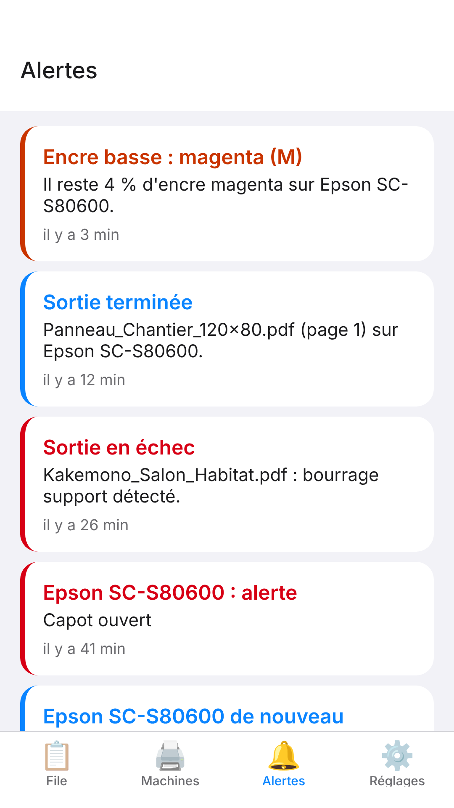

The **Alerts** (*Alertes*) tab keeps a record of the latest events, so you can find out what happened even if you missed the notification.

## Before you start

The app is connected to the server.

## Steps

1. Open the **Alerts** tab.
2. Look for the badge: it flags events you have not seen yet.
3. Browse the list, most recent first: each card gives the title, the detail (machine, file, message) and how long ago it happened.

## Good to know

- The history keeps the last 200 events: machine alerts, ink almost empty, failed outputs, unreachable machine.
- Machine alerts are shown in French; a message the RIP does not know yet stays in the machine's language.
- To be notified without opening the app, see [Turn on and set up mobile app notifications](rip-activer-les-notifications-de-l-application-mobile.md).

## See also

- [Turn on and set up mobile app notifications](rip-activer-les-notifications-de-l-application-mobile.md)
- [Understand the events the mobile app notifies](rip-comprendre-les-evenements-notifies.md)
- [A render fails](../rip-depannage/rip-un-rendu-echoue.md)
