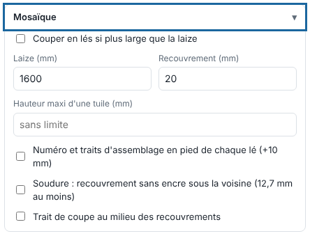

When a visual is wider than the roll, tiling splits it into panels that are glued or welded when fitted. This article is for operators.

## Before you start

You know the usable width of the roll. Overall settings are made when you send the file; unequal panels are set in the viewer.

## Steps

1. In the send panel, open the **Tiling** (*Mosaïque*) block.
2. Tick **Split into panels if wider than the roll** (*Couper en lés si plus large que la laize*), then set the **Roll width (mm)** (*Laize (mm)*) and the **Overlap (mm)** (*Recouvrement (mm)*): the area printed on both neighbouring panels, for gluing or welding. Panels start with equal widths.

   
3. Tick **Number and assembly marks at the foot of each panel (+10 mm)** (*Numéro et traits d'assemblage en pied de chaque lé (+10 mm)*): a 10 mm strip carries "Lé 2/3" (panel 2/3) and a vertical line where the neighbouring panel stops or starts, to align the panels when fitting.
4. If needed, set the **Maximum tile height (mm)** (*Hauteur maxi d'une tuile (mm)*): the page is then split into rows (columns × rows).
5. Tick **Welding: overlap with no ink under the neighbour (12.7 mm at least)** (*Soudure : recouvrement sans encre sous la voisine (12,7 mm au moins)*) if the panels are welded, and **Cut line in the middle of overlaps** (*Trait de coupe au milieu des recouvrements*) if the cut must follow.
6. Click **Send to the RIP** (*Envoyer au RIP*): each panel becomes a page of the job, with its own cut trimmed to its edge.
7. For unequal panels, open the page in the viewer: the **Panels** (*Lés*) panel shows the panels with dotted lines, their overlaps tinted and their numbers.
   - Drag a panel (or row) line, or enter the **Panel width** (*Largeur des lés*) and **Row height** (*Hauteur des rangées*) to the millimetre; **Equal panels** (*Lés égaux*) returns to an equal split.
   - Tick or untick **Tiles to print** (*Tuiles à imprimer*): an unticked tile is neither rendered nor queued. Click a tile's number to set its own **overlap** (negative = gap).
   - Enter the **Print order** (*Ordre d'impression*; for example `3 1 2`): those tiles first, then the others by number.
8. Click **Split into panels** (*Couper en lés*) to apply. On a job already in panels, **Apply** (*Appliquer*) keeps the changes and **Whole page (no tiling)** (*Page entière (sans mosaïque)*) goes back to a single page.

## Good to know

- With tiling, **Rotate automatically if the visual exceeds the roll width** (*Tourner seul si le visuel dépasse la laize*) has no effect (the panels take care of it).
- With **Flip every other panel** (*Retourner un lé sur deux*, a printer nesting setting), even panels are laid upside down for a shade match: see [Set up a printer's nesting](../rip-machines/rip-regler-l-imbrication-d-une-imprimante.md).
- The grid (columns × rows) is summarised in the **Panels** panel.

## See also

- [Print a label and a QR code in the margin](rip-imprimer-une-etiquette-et-un-qr-code.md)
- [Use the viewer to check a job](rip-utiliser-la-visionneuse.md)
- [Create a sheet to group prints](rip-creer-une-planche.md)
