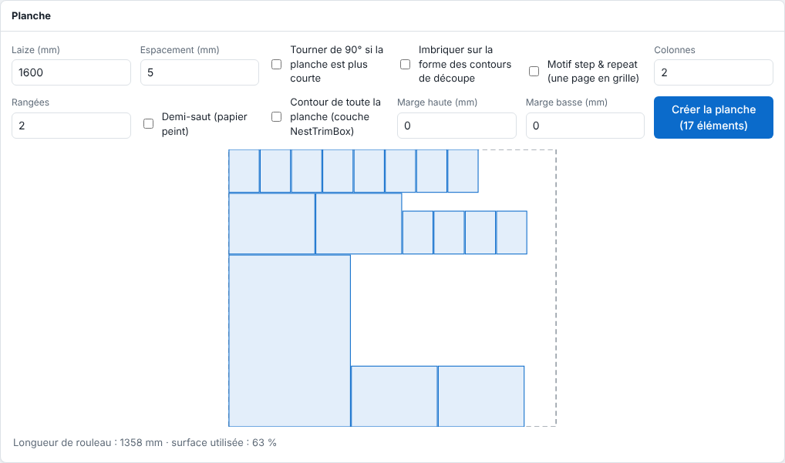

A sheet groups several items on a single roll to waste less media. This article describes how to create a sheet by hand.

## Before you start

Your jobs are PDFs whose pages are narrower than the roll. You know the usable width of the roll.

## Steps

1. On each printable page, click the job, tick **Add to sheet** (*Ajouter à la planche*) in the inspector and enter the number of copies.

   
2. In the **Sheet** (*Planche*) panel, above the list, set the **Roll width (mm)** (*Laize (mm)*; 1600 by default) and the **Spacing (mm)** (*Espacement (mm)*).
3. Look at the imposition drawn: each item in place, the roll length and the share of area used.

   
4. Tick **Rotate by 90° if the sheet is shorter** (*Tourner de 90° si la planche est plus courte*) if you accept rotating items.
5. If needed, tick **Nest on the shape of the cut outlines** (*Imbriquer sur la forme des contours de découpe*) to pack pieces tighter.
6. For a cutting table destination, set **Top margin (mm)** and **Bottom margin (mm)** (*Marge haute (mm)*, *Marge basse (mm)*), or tick **Outline of the whole sheet (NestTrimBox layer)** (*Contour de toute la planche (couche NestTrimBox)*).
7. Click **Create the sheet** (*Créer la planche*). The sheet becomes a new job, with the cut of all outlines.

## Good to know

- To repeat a single page in a grid, use the **Step & repeat pattern** (*Motif step & repeat*): columns, rows, spacing and **Half-drop** (*Demi-saut*).
- Only PDFs can be nested. A page wider than the roll fits on no sheet.
- Automatic nesting in the queue is set per machine (**System › Machines**, **Nesting** (*Imbrication*) field: **One by one** (*Un par un*), **Grouped in order** (*Groupé dans l'ordre*) or **Media saving** (*Économie de support*)). The sheet being prepared then appears in the **Queue** (*File d'attente*) view, with the **Print now** (*Imprimer maintenant*) button.
- Jobs only share a sheet if they have the same media, the same print mode, the same cutter and the same mirror.

## See also

- [Prepare a sheet for a cutting table](../rip-machines/rip-preparer-une-planche-pour-une-table-de-decoupe.md)
- [Refine a sheet: shapes, repeat and overall outline](rip-affiner-une-planche.md)
- [Follow a sheet being prepared in the queue](rip-suivre-une-planche-dans-la-file.md)
- [Send a job to the RIP](rip-envoyer-un-travail.md)
