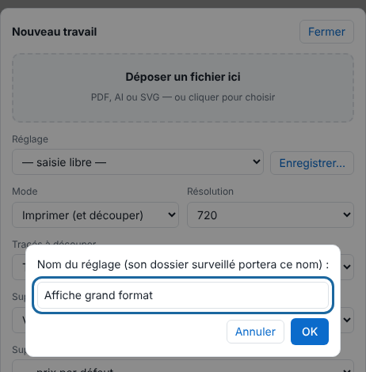
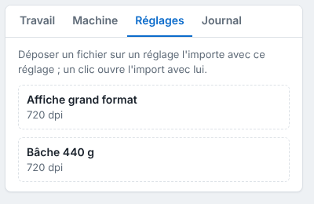

Each saved preset has its own folder: a file dropped in it becomes a job with that preset, without opening the client. This article is for workstations that send many identical files.

## Before you start

- A saved preset exists (**Save…** (*Enregistrer…*) button of the send panel; an administrator account is needed for the rules).
- The folder is reachable from your workstation (see [Share the hot folders](../rip-administration/rip-partager-les-dossiers-surveilles.md)).

## Steps

1. In **Administration…**, **Production** view, click **Import** (*Importer*), set the job as you want, then click **Save…** next to **Preset** (*Réglage*) and give the preset a name.

   
2. Check that the preset appears in the **Presets** (*Réglages*) tab, on the right of the table.

   
3. Open the preset's folder on the server: `/var/lib/eko-rip/entrees/<preset name>/`.
4. Drop a PDF, AI, SVG, TIFF, PNG or JPEG in it.
5. Wait for the copy to finish (the size must stay stable for 5 seconds): the file becomes a job with that preset.
6. Find the job in the client's table.

## Good to know

- You can also drag a file onto the preset in the **Presets** tab: it is imported with that preset.
- A refused file is moved to `refuses/`, with a `.refus.txt` file giving the reason.
- The automatic folder `/var/lib/eko-rip/entrees-auto/` picks the preset itself from rules: see [Set up the automatic folder](rip-regler-le-dossier-automatique.md).
- The file name can carry the preset, the machine, the copies, etc.: see [Name a file with tags](rip-nommer-un-fichier-avec-des-balises.md).
- The **One page per job** and **Refuse if a font is missing** boxes are mainly for hot folders: see [Split pages and reject doubtful files on arrival](rip-trier-les-fichiers-a-l-arrivee.md).
- A preset name may only contain letters, digits, spaces, `-`, `_` and `+`. To copy presets to another server: [Export and import saved presets](rip-exporter-et-importer-les-reglages.md).
- A saved preset also keeps the automatic queueing: a hot folder can therefore print by itself (see [Queue pages automatically](rip-mettre-en-file-automatiquement.md)).
- Hot folders do not need a RIP account: access is controlled by sharing the folder.

## See also

- [Share the hot folders](../rip-administration/rip-partager-les-dossiers-surveilles.md)
- [Send a job to the RIP](rip-envoyer-un-travail.md)
- [Back up the server configuration](../rip-administration/rip-sauvegarder-la-configuration.md)
