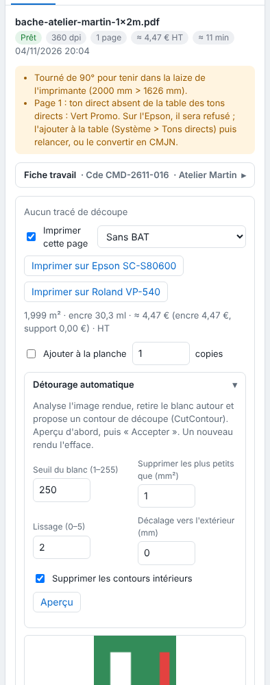

When the file has no cut path, the RIP can propose one from the rendered image. This article is for operators.

## Before you start

The job is the render of a printed PDF (auto contour does not apply to other formats).

## Steps

1. Click the job, then open the page's **Auto contour** (*Détourage automatique*) panel in the inspector.

   
2. Set the **White threshold (1–255)** (*Seuil du blanc*), **Remove those smaller than (mm²)** (*Supprimer les plus petits que*), the **Smoothing (0–5)** (*Lissage*) and the **Outward offset (mm)** (*Décalage vers l'extérieur*). Tick **Remove inner outlines** (*Supprimer les contours intérieurs*) to keep only the outer outline.
3. Click **Preview** (*Aperçu*): the number of outlines and their drawing are shown.
4. Adjust until the outline is right, then click **Accept** (*Accepter*): the cut files are rebuilt.
5. To remove it, click **Remove the auto contour** (*Retirer le détourage*).

## Good to know

- The RIP removes the white around the image and proposes a cut outline (`CutContour`).
- A new render erases the auto contour.
- Only the render of a PDF is concerned.

## See also

- [Understand the cut preflight check](rip-comprendre-le-controle-prealable-de-la-decoupe.md)
- [Extend the image near cut paths](rip-etendre-l-image-pres-des-traces-de-decoupe.md)
- [Set up a job for cutting](rip-mettre-en-coupe-un-travail.md)
