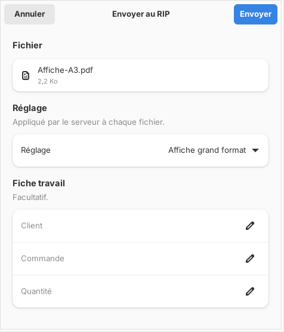

A job is born when you send a file to the RIP. This article shows how to send it with the settings you want.

## Before you start

The client is connected to the server. Your file is a PDF, an AI saved with "Create PDF Compatible File" (*Créer un fichier compatible PDF*), an SVG (cutting only) or a TIFF, PNG or JPEG image. Its size does not exceed 8 GB by default.

## Steps

1. In the client, click **+ Send** (*+ Envoyer*), or drag the file onto the window (on Mac, onto the Dock icon). You can drop several: they all go with the same settings.
2. Choose the **Preset** (*Réglage*) to apply, or a saved preset.
3. Choose the **Mode**: **Print (and cut)** (*Imprimer (et découper)*) or **Cut only** (*Découper seulement*).
4. Set the **Resolution** (*Résolution*; 360, 720 or 1440 dpi) and the **Media and print mode** (*Support et mode d'impression*).
5. If the job is cut, set the **Paths to cut** (*Tracés à découper*) and the **Cutter** (*Découpeuse*).
6. If needed, fill in the customer, the order and the quantity.
7. Click **Send to the RIP** (*Envoyer au RIP*).
8. Wait for the notification saying the render is ready, then click the job in the table to see its preview.

## Good to know

- From the moment you send, the server flags fonts that are not embedded and images under 100 ppi at their printed size. The job goes out anyway: it is up to you to judge.
- An image is placed at its real size, from the resolution saved in the file. With no resolution, the RIP assumes 72 ppi and the job flags it.
- If the page is wider than the roll but fits rotated by 90°, the RIP rotates it and says so with an alert (**Rotate automatically if the visual exceeds the roll width**, *Tourner seul si le visuel dépasse la laize*, ticked by default).
- The **Settings** (*Réglages*) button reopens these choices on an existing job; **Apply and render again** (*Appliquer et refaire le rendu*) starts again from the original without resending the file.
- Formats, spot colour channels and alpha channel: see [Check the accepted file formats](rip-connaitre-les-formats-de-fichier-acceptes.md).
- The send panel also has the **Colour**, **Quick edit**, **Automatic queueing**, **White**, **Background under the marks**, **Cutting tolerance** and **Tiling** blocks (*Couleur*, *Édition rapide*, *Mise en file automatique*, *Blanc*, *Fond sous les repères*, *Tolérance de découpe*, *Mosaïque*), which open with a click: see [Set up quick editing for a job](rip-regler-l-edition-rapide-d-un-travail.md) and [Queue pages automatically](rip-mettre-en-file-automatiquement.md).
- The **Kona registration** (*Repérage Kona*) adds marks around the image: see [Choose the Kona registration](../rip-machines/rip-choisir-le-reperage-kona.md).
- Message "Fichier trop volumineux pour le serveur." (file too large for the server): see [A render fails](../rip-depannage/rip-un-rendu-echoue.md).

## See also

- [Follow jobs and start printing](rip-suivre-les-travaux.md)
- [Drop a file in a hot folder](rip-deposer-un-fichier-dans-un-dossier-surveille.md)
- [Set up a media and its print modes](../rip-couleur/rip-regler-un-support-et-ses-modes.md)
- [Get to know the client screen](rip-prendre-en-main-l-ecran-du-client.md)
