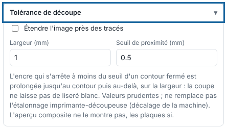

Cutting tolerance extends ink that stops just short of the cut outline, to hide a small blade offset. This article is for operators.

## Before you start

The job is printed and cut, with closed outlines. Set the printer-cutter calibration first: the tolerance does not replace it.

## Steps

1. In the send panel, open the **Cutting tolerance** (*Tolérance de découpe*) block.
2. Tick **Extend the image near paths** (*Étendre l'image près des tracés*).
3. Set the **Proximity threshold (mm)** (*Seuil de proximité (mm)*): ink that stops within this distance of a closed outline is extended up to the outline.
4. Set the **Width (mm)** (*Largeur (mm)*; 0.1 to 10 mm): the ink is extended past the outline by this width.

   
5. Click **Send to the RIP** (*Envoyer au RIP*).
6. Check the plates in the viewer.

## Good to know

- The composite preview does not show the extension; the plates do.
- Keep values cautious.
- For a job that is already rendered, reopen the **Settings** and render again.

## See also

- [Set up a job for cutting](rip-mettre-en-coupe-un-travail.md)
- [Fix a cut that is offset from the print](../rip-depannage/rip-decoupe-decalee.md)
- [Use the viewer to check a job](rip-utiliser-la-visionneuse.md)
