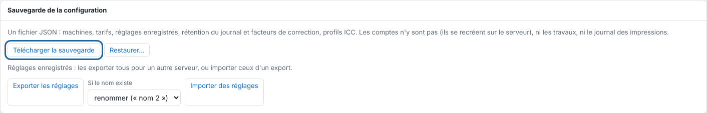

A saved preset keeps the whole send panel under a name. This article shows how to create presets cleanly and transfer them to another server. It is for the administrator.

## Before you start

You need an administrator account for export and import (**System** > **Configuration backup**, *Système* > *Sauvegarde de la configuration*).

## Steps

1. To create a preset, click **Import** (*Importer*), set the panel, then click **Save…** (*Enregistrer…*) next to **Preset** (*Réglage*) and give a name (letters, digits, spaces, `-`, `_`, `+`). Choosing it in **Preset** fills the panel; **Delete** (*Supprimer*) removes it.
2. Open **Administration…**, **System** view, **Configuration backup** section.
3. Click **Export presets** (*Exporter les réglages*): all saved presets are downloaded in one file, for another server.
4. On the other server, choose **If the name exists** (*Si le nom existe*): **rename ("name 2")** (*renommer (« nom 2 »)*) or **overwrite** (*écraser*).
5. Click **Import presets** (*Importer des réglages*) and choose the file.

   

## Good to know

- Everything is checked before writing: an invalid file writes nothing.
- Each preset has a hot folder of the same name (see [Drop a file in a hot folder](rip-deposer-un-fichier-dans-un-dossier-surveille.md)).
- To keep the whole server (presets, rules, machines), see [Back up the server configuration](../rip-administration/rip-sauvegarder-la-configuration.md).

## See also

- [Drop a file in a hot folder](rip-deposer-un-fichier-dans-un-dossier-surveille.md)
- [Back up the server configuration](../rip-administration/rip-sauvegarder-la-configuration.md)
- [Set up the automatic folder](rip-regler-le-dossier-automatique.md)
