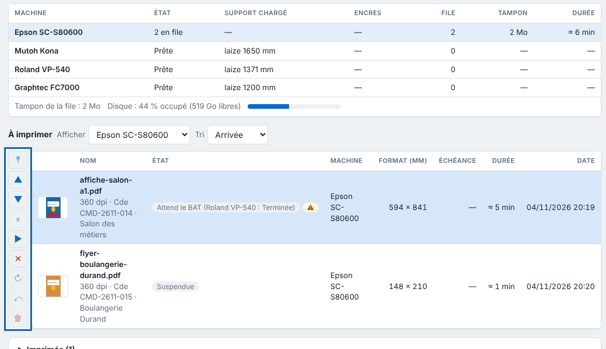
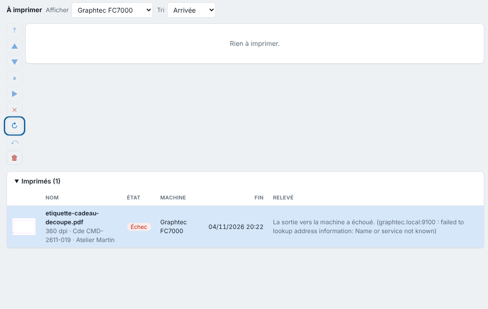

Each machine runs one output at a time, in the order of its queue. This article shows how to reorder the queue and read the waiting reasons.

## Before you start

Outputs are in the queue (see [Follow jobs and start printing](rip-suivre-les-travaux.md)). An **Operator** (*Opérateur*) account is enough.

## Steps

1. Open the machine's queue: click its name in the machines table (**Production** view), in the sidebar or in the clients' **Queue** (*File d'attente*) view.
2. Click the output to handle.
3. To change the order, click **To front** (*En tête*), **Up** (*Monter*) or **Down** (*Descendre*). You can also drag a waiting output onto the place of another one on the same machine.

   
4. To set it aside, click **Hold** (*Suspendre*); the following ones go ahead of it. Click **Resume** (*Reprendre*) to release it.
5. To abandon it, click **Cancel** (*Annuler*).
6. To run it again, open **Printed** (*Imprimés*; **History**, *Historique*, in the clients) and click **Redo** (*Refaire*): the same output goes again without rendering again.

   
7. To clean up the history, click **Remove** (*Retirer*).

## Good to know

An output that cannot go shows a red badge (hover for the detail) and lets the following ones through (details: [Understand why an output waits](rip-comprendre-les-raisons-d-attente-d-une-sortie.md)):

- **Machine unreachable**: it goes as soon as the machine answers;
- **Missing file**: rerun the job;
- **Too wide**: the page, marks included, exceeds the width of the machine or of the loaded roll;
- **Other media**: it goes by itself when the right media is loaded;
- **Print not finished**: a cut waits for the print of its page to finish;
- **Cutter unavailable**: the print waits, so as not to waste ink;
- **Nesting**: the print waits for its sheet;
- **Page excluded**: the **Print this page** box is unticked.

Each print still to run shows its **estimated duration**, and the column header shows the total remaining; the job ticket too. Estimate: printed length × machine roll width ÷ speed. Default Epson speed: 94 m²/h up to 360 dpi, 17 m²/h at 720 dpi (720 × 1440, 6 passes), 6.6 m²/h beyond. When an output finishes or fails, the screen says so, and so does the system if the client is allowed to display notifications.

Cut spot colours (`CutContour`...) never go to the printer. For an Epson with a **Folder** (*Dossier*) connection, nothing is printed: the finished output shows **Déposée dans le dossier (pas imprimée)** (dropped in the folder, not printed) (see [Understand the Epson direct driver](../rip-machines/rip-comprendre-le-pilote-direct-de-l-epson.md)). The Kona cut goes through the plotter port (`/dev/kona`).

Each print shows its estimated duration. To adjust it, measure the real speed and enter it as the machine's **Speed (m²/h)** (*Cadence (m²/h)*). An output interrupted by a server stop goes to *Échec* (failed): **Redo** restarts it. The **Archive** (*Archive*) keeps archived cuts, which **Restore** (*Restaurer*) puts back in the queue.

## See also

- [Create a sheet to group prints](rip-creer-une-planche.md)
- [The output to the machine failed](../rip-depannage/rip-sortie-vers-la-machine-echouee.md)
- [Understand why an output waits](rip-comprendre-les-raisons-d-attente-d-une-sortie.md)
- [Add a machine to the RIP](../rip-machines/rip-ajouter-une-machine.md)
