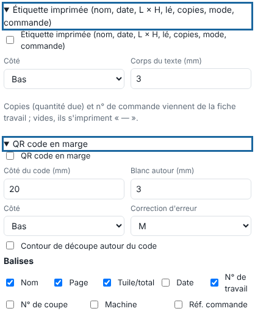

The label and the QR code identify each panel on the printed media. This article is for operators.

## Before you start

You are in **Quick edit** (*Édition rapide*), when sending a file. To fill in copies and order, complete the job ticket (see [Fill in the job ticket](rip-renseigner-la-fiche-travail.md)).

## Steps

1. Open the **Printed label** (*Étiquette imprimée*) block and tick it.
2. Choose the **Side** (*Côté*; top or bottom of each panel) and the **Text size** (*Corps du texte*, mm).
3. Open the **QR code in the margin** (*QR code en marge*) block and tick it.
4. Choose the code's **Side**, the **Code size** (*Côté du code*, mm), the **White around** (*Blanc autour*, mm) and the **Error correction** (*Correction d'erreur*; L, M, Q, H).
5. In **Tags** (*Balises*), tick what the code carries: name, page, tile/total, date, job no., cut no., machine, order ref.
6. For a cut around the code, tick **Cut outline around the code** (*Contour de découpe autour du code*).

   
7. Click **Send to the RIP** (*Envoyer au RIP*).

## Good to know

- The label carries the name, the date, W × H, the panel, the copies, the mode and the order.
- Copies and order reference print empty ("—") until the job ticket exists.
- The margin grows by itself to hold the label and the code.

## See also

- [Fill in the job ticket](rip-renseigner-la-fiche-travail.md)
- [Set up quick editing for a job](rip-regler-l-edition-rapide-d-un-travail.md)
- [Split a page into panels and tiles](rip-couper-une-page-en-les-et-en-tuiles.md)
