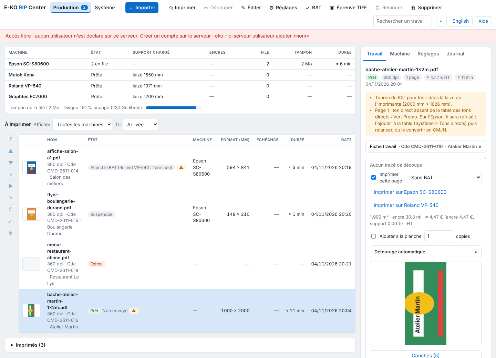

The **Production** view shows the state of the machines, the queue and the finished outputs at a glance. This article explains each area for operators.

## Before you start

An **Operator** (*Opérateur*) account is enough. The **Production** view is the first one in the client, next to **System** (*Système*).

## Steps

1. Read the **Machines** area, at the top: one row per machine, with its state (ready, running with the output in progress, unreachable), the loaded media, the Epson's ink levels, the number of outputs in the queue, their weight in the spool (the plates to send) and the time remaining.
2. Click a row to show only that machine; a second click shows them all again (same choice as the **Show** (*Afficher*) list).
3. Under the table, read the spool of the whole queue and the data disk (% used, free space, gauge). The gauge turns red when free space drops below the purge threshold (`EKO_RIP_SEUIL_LIBRE_MO`). These counters refresh with the queue.
4. Read the **To print** (*À imprimer*) area: the outputs in the queue, in queue order, then the jobs not yet sent ("Non envoyé", not sent). Columns: thumbnail, name, state, machine, size, due date, time, date. Sheets being prepared are shown above.
5. Use the column of buttons on the left to act on the chosen output: **To front**, **Up**, **Down**, **Hold**, **Resume**, **Cancel**, **Redo**, **Restore**, **Remove** (*En tête*, *Monter*, *Descendre*, *Suspendre*, *Reprendre*, *Annuler*, *Refaire*, *Restaurer*, *Retirer*).
6. Open the collapsible **Printed** (*Imprimés*) area (with their count): finished, failed or cancelled outputs, most recent first, with the end time and the ink and media reading.
7. Click a row: the **inspector**, on the right, opens the job. It has four tabs: **Job**, **Machine**, **Presets** and **Log** (*Travail*, *Machine*, *Réglages*, *Journal*).

   

## Good to know

- **Job** tab: the job detail (see [Follow jobs and start printing](rip-suivre-les-travaux.md)). **Machine** tab: the media, inks, heaters and alerts of the displayed machine or the chosen output. **Presets** tab: dropping a file on a preset imports it with that preset; a click opens the import with it. **Log** tab: the screen's messages, most recent first.
- **Right-click** on a row: the output's queue actions, then those of the toolbar. On a machine: show only it, see its state, reread the Epson, configure it. On a table header: the columns to show or hide (name, state and thumbnail stay; the choice is kept by the workstation).
- **Drag and drop**: in **To print**, a waiting or held output can be dropped in the place of another one on the same machine.
- A greyed button does not apply to the state of the chosen output.
- The number of outputs still to run is shown on the **Production** button.
- When an output finishes or fails, the screen says so, and so does the system if the client is allowed to display notifications.

## See also

- [Manage a machine's queue](rip-gerer-la-file-d-une-machine.md)
- [Understand why an output waits](rip-comprendre-les-raisons-d-attente-d-une-sortie.md)
- [Get to know the client screen](rip-prendre-en-main-l-ecran-du-client.md)
