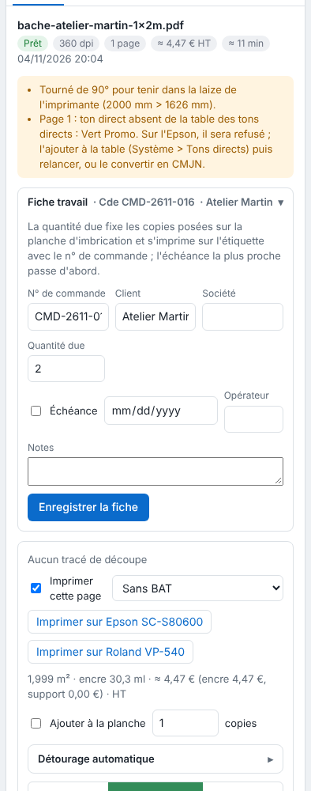

The RIP checks every file it receives and flags what may go wrong. Alerts never stop a job from going out: it is up to you to judge.

## Before you start

A job has been received. The ⚠ badge appears next to its state in the table.

## Steps

1. Click the job in the table: the alerts appear at the top of the inspector.

   
2. Read each alert. The most common ones:
   - **font not embedded**: another font will be used at render. Outline the text or embed the font, then send the file again;
   - **image under 100 ppi** at its printed size: the image will be blurry. Use a higher-resolution image;
   - **spot colour missing from the table**: see [Declare the workshop's spot colours](../rip-couleur/rip-declarer-les-tons-directs.md);
   - **cut alerts** (path touching the edge, RGB colour, etc.): see [Understand the cut preflight check](rip-comprendre-le-controle-prealable-de-la-decoupe.md);
   - **registration alert**: an image under 25 cm on a side is flagged for Kona registration.
3. Fix the file and send it again, or accept the alert and queue the job.

## Good to know

- To refuse automatically files with a missing font, tick **Refuse if a font is missing** (*Refuser si une police manque*): see [Split pages and reject doubtful files on arrival](rip-trier-les-fichiers-a-l-arrivee.md).
- A 90° rotation made by the RIP (**Rotate automatically if the visual exceeds the roll width**, *Tourner seul si le visuel dépasse la laize*) is flagged by an alert.
- An image with no saved resolution is counted at 72 ppi, and the job flags it.
- A failed TIFF proof is flagged in the alerts, without stopping the job.
- A file name that does not follow the tag pattern adds the alert "Nom hors du motif à balises" (name outside the tag pattern) or "Balise du nom non reconnue" (tag in the name not recognised): see [Name a file with tags](rip-nommer-un-fichier-avec-des-balises.md).

## See also

- [Follow jobs and start printing](rip-suivre-les-travaux.md)
- [Send a job to the RIP](rip-envoyer-un-travail.md)
- [Fix a failed render or a refused file](../rip-depannage/rip-un-rendu-echoue.md)
