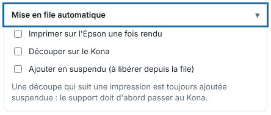

Automatic queueing sends each page to the right machine as soon as the render is done, without a click. It is mainly used with hot folders. This article is for operators.

## Before you start

The printer and the cutter are declared in the machine catalogue (see [Add a machine to the RIP](../rip-machines/rip-ajouter-une-machine.md)). To cut, choose the **Cutter** (*Découpeuse*) in the send panel.

## Steps

1. Click **Import** (*Importer*), then open the **Automatic queueing** (*Mise en file automatique*) block.
2. Tick **Print on the Epson once rendered** (*Imprimer sur l'Epson une fois rendu*): each printable page goes to the Epson's queue.
3. Tick **Cut on the Kona** (*Découper sur le Kona*; or on the cutter chosen at import): each page to cut goes to the cutter's queue.
4. Tick **Add as held (to release from the queue)** (*Ajouter en suspendu (à libérer depuis la file)*) if you want the outputs to wait: you import ten files and release the ones you want.

   
5. Click **Send to the RIP** (*Envoyer au RIP*).
6. To release a held output, open the machine's queue, click the output, then **Resume** (*Reprendre*).
7. To keep this choice, click **Save…** (*Enregistrer…*) next to **Preset** (*Réglage*): a hot folder that uses this preset then prints by itself.

## Good to know

- A cut that follows a print is always added as held: the media must first move to the cutter. It also waits until the print of its page is 100% finished.
- You can choose several files at once: each goes with the same settings.
- The setting is saved with the others (see [Drop a file in a hot folder](rip-deposer-un-fichier-dans-un-dossier-surveille.md)).
- Without automatic queueing, you queue the page with **Print on…** and **Cut on…** (see [Follow jobs and start printing](rip-suivre-les-travaux.md)).
- With **Proof only** (*Épreuve seule*; see [Make a TIFF proof](../rip-couleur/rip-faire-une-epreuve-tiff.md)), queueing a print is refused.

## See also

- [Choose the cutter for a job](rip-choisir-la-decoupeuse-d-un-travail.md)
- [Manage a machine's queue](rip-gerer-la-file-d-une-machine.md)
- [Drop a file in a hot folder](rip-deposer-un-fichier-dans-un-dossier-surveille.md)
