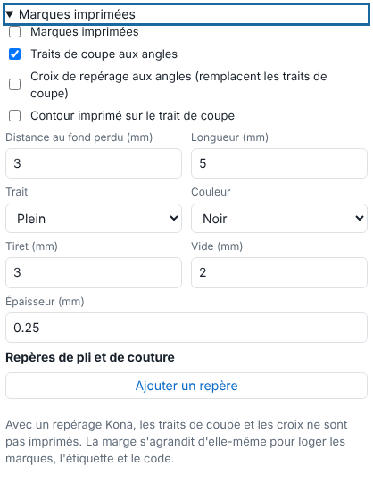

Grommets and marks guide finishing: fitting a banner's grommets, cutting at the corners, folding or sewing. This article is for operators.

## Before you start

You are in the **Quick edit** (*Édition rapide*) block of the send panel or of a finished job's edit (see [Set up quick editing for a job](rip-regler-l-edition-rapide-d-un-travail.md)).

## Steps

1. Tick **Grommets (printed marks)** (*Œillets (repères imprimés)*).
2. Choose the **Distribution** (*Répartition*): **by spacing** (*par espacement*; set the **Maximum gap**, *Écart maximal*, in mm) or **by quantity** (*par quantité*; enter a **Number per edge**, *Nombre par bord*, corners included: top, bottom, left, right).
3. Set the **Distance from the edge** (*Distance au bord*, mm), the **Diameter** (*Diamètre*, mm), the edges concerned (**Top**, **Bottom**, **Left**, **Right**) and the **Shape** (*Forme*): circle, solid disc, cross, circle and cross. Corners are included.
4. If the inset must start from the cut outline rather than the edge, tick **Distance counted from the cut line (inward)** (*Distance comptée depuis le trait de coupe (vers l'intérieur)*).
5. Open **Printed marks** (*Marques imprimées*) and tick **Printed marks**. Choose:
   - **Cut lines at the corners** (*Traits de coupe aux angles*), with the **Distance from the bleed** (*Distance au fond perdu*) and the **Length** (*Longueur*); or **Registration crosses at the corners** (*Croix de repérage aux angles*; they replace the cut lines);
   - **Printed outline on the cut line** (*Contour imprimé sur le trait de coupe*).

   
6. For a fold or a seam, click **Add a mark** (*Ajouter un repère*), choose the side and the **distance from the side**. Tick **Seam (continuous line)** (*Couture (trait continu)*) if needed. Untick **Printed** (*Imprimé*) so the mark is not printed.
7. Set the **Line** (*Trait*): solid, dotted or alternating (dashes on white), with **Dash** (*Tiret*), **Gap** (*Vide*), **Thickness** (*Épaisseur*) and **Colour** (*Couleur*; black, CMYK 100% registration, white).
8. Click **Send to the RIP** (*Envoyer au RIP*).

## Good to know

- 20 fold and sewing marks at most.
- Marks are placed outside the bleed (see [Add a bleed](rip-ajouter-un-fond-perdu.md)).
- With Kona registration, cut lines and crosses are not printed (they would interfere with reading the marks): an alert on the job says so.
- The margin grows by itself to hold the marks.

## See also

- [Set up quick editing for a job](rip-regler-l-edition-rapide-d-un-travail.md)
- [Choose the Kona registration](../rip-machines/rip-choisir-le-reperage-kona.md)
- [Add a bleed](rip-ajouter-un-fond-perdu.md)
