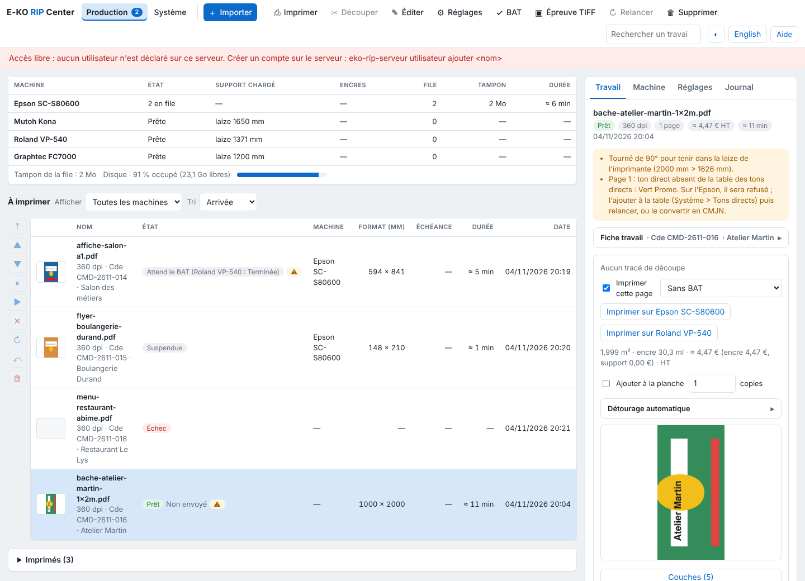

The client screen reads like a RIP queue: you drop a file, follow the job, queue it on a machine. This article presents each area, for operators who are new to the client.

## Before you start

The E-KO RIP Center client is installed and connected to the server (see [Connect to the server](../rip-premiers-pas/rip-se-connecter-au-serveur.md)). If the server has accounts, the client first asks for your username and password.

## Steps

1. Look at the **top**: the toolbar. It contains **Import** (*Importer*), then the actions that apply to the chosen job: **Print** (*Imprimer*), **Cut** (*Découper*), **Edit** (*Éditer*), **Settings** (*Réglages*), **Proof** (*BAT*), **TIFF proof** (*Épreuve TIFF*), **Rerun** (*Relancer*) and **Delete** (*Supprimer*). A greyed button does not apply to the state of the chosen job.
2. Find, on the right of the bar, the **search** (name, order no., customer or company), the theme button (dark or light, ◐) and the language choice.
3. Look at the **left** (native clients): the **views** (**Jobs**, **Queue**, **System**; *Travaux*, *File d'attente*, *Système*), the catalogue's **machines** with the number of outputs in the queue (a click opens their queue) and the **saved presets** (a click opens the import with that preset).
4. Look at the **centre**: the jobs table.
5. Look at the **right**: the **inspector** of the chosen job (preview, alerts, job ticket, **Print on…** and **Cut on…** buttons).

   
6. Click **Import** to send a file (see [Send a job to the RIP](rip-envoyer-un-travail.md)).

## Good to know

- In the administration web client, the **Production** view replaces **Jobs** and **Queue**: see [Read the Production screen](rip-lire-l-ecran-production.md).
- On a screen narrower than 1100 px, the inspector moves below the tables; under 1360 px, the toolbar tools keep their symbol and their name moves to a tooltip.
- The choice of theme and language is kept by the workstation.
- The **System** view gathers the server version, cutting, machines, media, costs and backups: see [Read the System view](../rip-couleur/rip-lire-la-vue-systeme.md).

## See also

- [Read the Production screen](rip-lire-l-ecran-production.md)
- [Follow jobs and start printing](rip-suivre-les-travaux.md)
- [Send a job to the RIP](rip-envoyer-un-travail.md)
