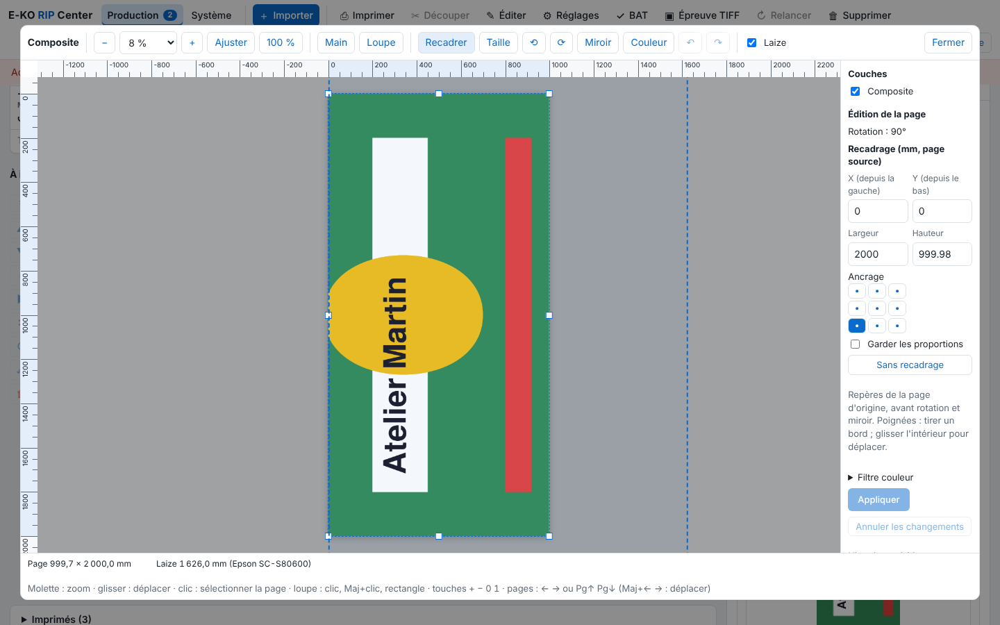

The viewer's editing tools fix a page without resending the file. This article is for operators.

## Before you start

The job is a rendered PDF, without tiling: the editing tools only open in that case. A job that has an output in the queue cannot be edited.

## Steps

1. Open the page in the viewer (see [Use the viewer to check a job](rip-utiliser-la-visionneuse.md)).
2. To crop, click **Crop** (*Recadrer*). Drag an edge or a handle, or drag the inside to move. You can also enter X (from the left), Y (from the bottom), **Width** (*Largeur*) and **Height** (*Hauteur*), in mm of the original page, before rotation and mirror. Choose the **Anchor** (*Ancrage*) on 9 points, tick **Keep proportions** (*Garder les proportions*), or click **No crop** (*Sans recadrage*).

   
3. To change the size, click **Size** (*Taille*). Set the **Printed size** (*Taille imprimée*) in width and height (mm) or in %. Corners act proportionally, sides freely. Untick **Linked proportions** (*Proportions liées*) to set width and height separately: the cut is distorted the same way. The top-left corner stays fixed.
4. To rotate, click **Rotate 90° left** (⟲) or **right** (⟳). To flip, click **Mirror** (*Miroir*), then choose **The mirror flips** (*Le miroir retourne*): the image and the cut, or the image only.
5. Click **Apply** (*Appliquer*): the render is redone. **Cancel changes** (*Annuler les changements*) goes back to the rendered state.

## Good to know

- A frame that goes outside the page is refused (1 × 1 mm at least).
- **Undo / redo**: ↶ and ↷, or Ctrl+Z (Cmd+Z), Shift+Ctrl+Z and Ctrl+Y; 50 states at most. Going back to an already rendered state renders again; a state that was only typed in comes back in the panel.
- During a crop or a size change with Kona registration, the marks are drawn dotted around the upcoming size.
- The "image only" mirror choice needs to be tested at the workshop. A mirrored job carries the **Mirror** badge in the queue.

## See also

- [Set up quick editing for a job](rip-regler-l-edition-rapide-d-un-travail.md)
- [Use the viewer to check a job](rip-utiliser-la-visionneuse.md)
- [Retouch a job's colours with the colour filter](../rip-couleur/rip-retoucher-les-couleurs-avec-le-filtre-couleur.md)
