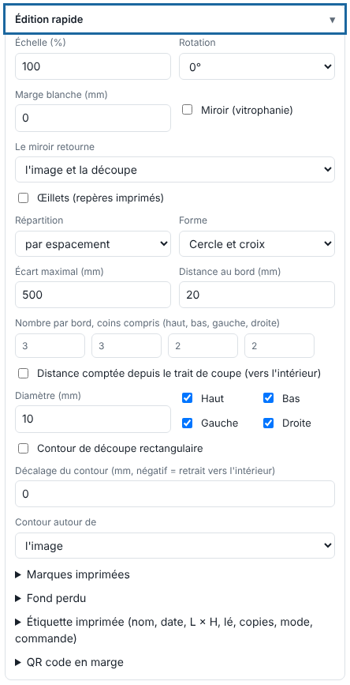

Quick edit fixes a file without going back to the layout software: size, direction, mirror, outline. This article is for operators.

## Before you start

You are sending a file (**Import**, *Importer*), or you have a finished job. A job that has an output in the queue cannot be edited: cancel or finish the output first.

## Steps

1. For a new file, click **Import** and open the **Quick edit** (*Édition rapide*) block. For a finished job, click the job, then **Edit** (*Éditer*) in the toolbar: the render is redone from the original file, without resending it.

   
2. Set the **Scale** (*Échelle*, %) and the **Rotation** (0, 90, 180 or 270°).
3. Set the **White margin** (*Marge blanche*, mm) around the image.
4. For window film (a lightbox seen from behind), tick **Mirror (window film)** (*Miroir (vitrophanie)*), then choose **The mirror flips** (*Le miroir retourne*): **the image and the cut** (default) or **the image only**.
5. For a rectangular cut, tick **Rectangular cut outline** (*Contour de découpe rectangulaire*). Set the **Outline offset** (*Décalage du contour*, mm; negative = inset) and choose **Outline around** (*Contour autour de*): the image, the bleed, or the trim box (bleed + trim).
6. Click **Send to the RIP** (*Envoyer au RIP*), or **Apply** (*Appliquer*) when editing a finished job.

## Good to know

- The "image only" mirror needs to be tested at the workshop: depending on the layout, the cut must follow the image or not.
- The cut follows the edit (scale, rotation, mirror).
- The margin grows by itself to hold the marks, the label and the code.
- A mirrored job carries the **Mirror** badge in the queue.
- With a rotation chosen here, **Rotate automatically if the visual exceeds the roll width** has no effect.
- For grommets and marks, see [Add grommets and printed marks](rip-poser-des-oeillets-et-des-marques-imprimees.md). To crop or resize on the preview, see [Crop, resize or rotate a page](rip-recadrer-redimensionner-ou-tourner-une-page.md).

## See also

- [Add grommets and printed marks](rip-poser-des-oeillets-et-des-marques-imprimees.md)
- [Add a bleed](rip-ajouter-un-fond-perdu.md)
- [Send a job to the RIP](rip-envoyer-un-travail.md)
