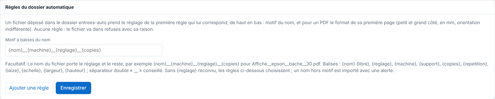

The automatic folder picks a file's preset by itself from its name and format. This article is for the administrator.

## Before you start

You need an administrator account. The presets the rules must apply already exist (see [Drop a file in a hot folder](rip-deposer-un-fichier-dans-un-dossier-surveille.md)). The folder is `/var/lib/eko-rip/entrees-auto/` on the server.

## Steps

1. Open **Administration…**, **System** view, **Automatic folder rules** (*Règles du dossier automatique*) block.
2. Click **Add a rule** (*Ajouter une règle*).
3. Enter the **Name pattern** (*Motif du nom*): `*` stands for any characters, `?` for a single one, ignoring capitals.
4. If needed, enter the **Short side** (*Petit côté*) and the **Long side** (*Grand côté*) (mm, optional): the size of a PDF's first page, whatever its orientation. An empty bound means 0 or 100 m.
5. Choose the preset to apply.
6. Order the rules: they are tried from top to bottom (**↑** moves a rule up), and the first one that matches gives its preset.
7. Click **Save** (*Enregistrer*).

   
8. Drop a file in `entrees-auto/` to check.

## Good to know

- Example: `BACHE_*` → Banner; `*.pdf`, long side from 2000 to empty → Large format; `*` → Vinyl.
- `BACHE_*` matches `BACHE_client-12.pdf`, not `affiche_BACHE.pdf`.
- A size rule never takes a file whose size cannot be read (image, SVG, PDF over 512 MB): put a rule without a size after it.
- A file that no rule takes goes to `entrees-auto/refuses/` with its reason (`.refus.txt` file).
- The rules are in the configuration backup (see [Back up the server configuration](../rip-administration/rip-sauvegarder-la-configuration.md)).
- For the name to also carry the machine, copies or scale, see [Name a file with tags](rip-nommer-un-fichier-avec-des-balises.md).

## See also

- [Name a file with tags](rip-nommer-un-fichier-avec-des-balises.md)
- [Drop a file in a hot folder](rip-deposer-un-fichier-dans-un-dossier-surveille.md)
- [Share the hot folders](../rip-administration/rip-partager-les-dossiers-surveilles.md)
