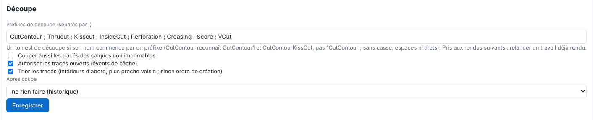

The RIP recognises a cut path by its spot colour name. This article explains how to adapt that to your workshop's habits. It is for the administrator.

## Before you start

You need an administrator account. Your files name their cut spot colours consistently.

## Steps

1. Open **Administration…**, **System** view, **Cutting** (*Découpe*) block.
2. In **Cut prefixes (separated by ;)** (*Préfixes de découpe (séparés par ;)*), enter the prefixes. A spot colour is a cut colour if its name **starts** with a prefix.

   
3. Click **Save** (*Enregistrer*).
4. Rerun the jobs already rendered: a change applies to later renders.

## Good to know

- Default prefixes: `CutContour`, `Thrucut`, `Kisscut`, `InsideCut`, `Perforation`, `Creasing`, `Score`, `VCut`.
- Capitals, spaces and dashes do not matter: `CutContour` recognises `CutContour1` and `CutContourKissCut`, not `1CutContour`.
- A cut spot colour at 0% is not cut.
- With **All paths** (*Tous les tracés*; the **Paths to cut** choice when sending), every path in the file is cut: handy for cut-only files.
- Paths are clipped to the page, and to the frame of a PDF form: the blade never leaves the media.
- Cut spot colours are never printed and do not erase the ink under them, even without overprint: at render they become the `None` colorant of the PDF standard. So there is no white edge along the cut.
- To also cut paths on non-printable layers, tick **Also cut paths on non-printable layers** (*Couper aussi les tracés des calques non imprimables*; see [Set open paths, sorting and after-cut](rip-regler-les-traces-ouverts-le-tri-et-l-apres-coupe.md)).

## See also

- [Understand the cut preflight check](rip-comprendre-le-controle-prealable-de-la-decoupe.md)
- [Order the cut layers](rip-ordonner-les-couches-de-decoupe.md)
- [Set open paths, sorting and after-cut](rip-regler-les-traces-ouverts-le-tri-et-l-apres-coupe.md)
