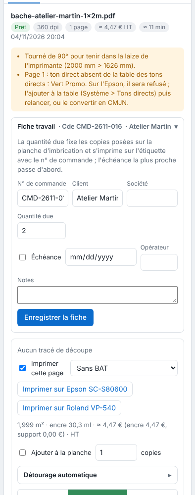

The job ticket keeps a job's order information. The quantity due and the due date are also used for nesting. This article is for operators.

## Before you start

A job has been received (see [Send a job to the RIP](rip-envoyer-un-travail.md)). An **Operator** (*Opérateur*) account is enough.

## Steps

1. Click the job in the table.
2. In the inspector, open the **Job ticket** (*Fiche travail*): it is collapsed under its title, with its summary (order no., customer).
3. Fill in the fields you want: **Order no.**, **Customer**, **Company**, **Quantity due**, **Due date**, **Operator** and **Notes** (*N° de commande*, *Client*, *Société*, *Quantité due*, *Échéance*, *Opérateur*, *Notes*). For the due date, tick the box, then choose the date.
4. Click **Save the ticket** (*Enregistrer la fiche*).

   
5. To sort the queue by deadline, choose **Due date** in the **Sort** (*Tri*) list above the table; **Arrival** (*Arrivée*) goes back to arrival order.

## Good to know

- Limits: 200 characters per field, 2000 for notes, quantity of 100,000 at most.
- The **Quantity due** is the number of **copies** placed on the nesting sheet; it is printed on the label with the order no.
- The **due date** is the nesting priority: the nearest goes first, then jobs with no due date, then arrival order. The table has a **Due date** column.
- The search bar filters by name, order no., customer or company.
- **Operator** appears in the print log.
- A file name can fill in the quantity: see [Name a file with tags](rip-nommer-un-fichier-avec-des-balises.md).

## See also

- [Print a label and a QR code in the margin](rip-imprimer-une-etiquette-et-un-qr-code.md)
- [Follow a sheet in the queue](rip-suivre-une-planche-dans-la-file.md)
- [View the print log](../rip-couleur/rip-consulter-le-journal-des-impressions.md)
