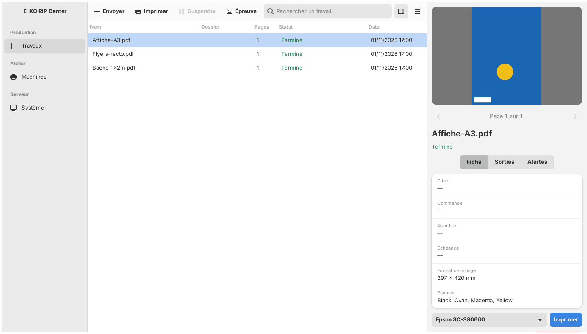

After sending, you follow each job in the client, then queue it on a machine. This article is for operators.

## Before you start

A file has been sent (see [Send a job](rip-envoyer-un-travail.md)). An **Operator** (*Opérateur*) account is enough.

## Steps

1. Open the **Jobs** (*Travaux*) view. The table lists the name, folder, pages, state and date. Use the search to filter by name, order number, customer or company.
2. Click a job: the inspector, on the right, shows the preview, the ticket, the ink plates and the alerts.
3. Read the alerts (⚠ badge) before going further.
4. Click **Print on…** (*Imprimer sur…*) for the machine you want. The page enters that machine's queue.
5. For a cut, click **Cut on…** (*Découper sur…*) for the cutter you want.
6. If needed, open the job ticket: **Order no.**, **Customer**, **Company**, **Quantity due**, **Due date**, **Operator** and **Notes**, then **Save the ticket** (*Enregistrer la fiche*).

## Good to know

- The badge next to each button gives the state of the last output.
- The **Print this page** (*Imprimer cette page*) box is ticked by default. Unticked, the page enters neither the queue nor a sheet.
- On the right of the table, the inspector has four tabs (**Job**, **Machine**, **Presets**, **Log**): see [Read the Production screen](rip-lire-l-ecran-production.md).
- The inspector shows one section per page with the number of cut paths, the composite preview (with the media profile proof) and, behind the **Layers** (*Couches*) button, the cut and a thumbnail per plate. On a job to cut, it adds the **Cut layers** and **Cut setup** panels.
- Alerts and the job ticket have their own articles: [Read a job's alerts](rip-lire-les-alertes-d-un-travail.md) and [Fill in the job ticket](rip-renseigner-la-fiche-travail.md).
- **.plt file** (*Fichier .plt*) downloads the cut: HP-GL, 0.010 mm per step, origin at the bottom-left corner of the page.
- **Rerun** (*Relancer*) redoes a failed job. **Delete** (*Supprimer*) removes a finished job, but not while an output is waiting for it in the queue.
- To print and cut without intervention, tick **Automatic queueing** when sending. **Add as held** puts the outputs on hold, to release them later from the queue.
- A cut that follows a print is always added as held: the media must first move to the cutter.

## See also

- [Manage a machine's queue](rip-gerer-la-file-d-une-machine.md)
- [Approve a proof](rip-valider-un-bat.md)
- [Follow production from the mobile app](rip-suivre-la-production-sur-mobile.md)
- [Read the Production screen](rip-lire-l-ecran-production.md)
