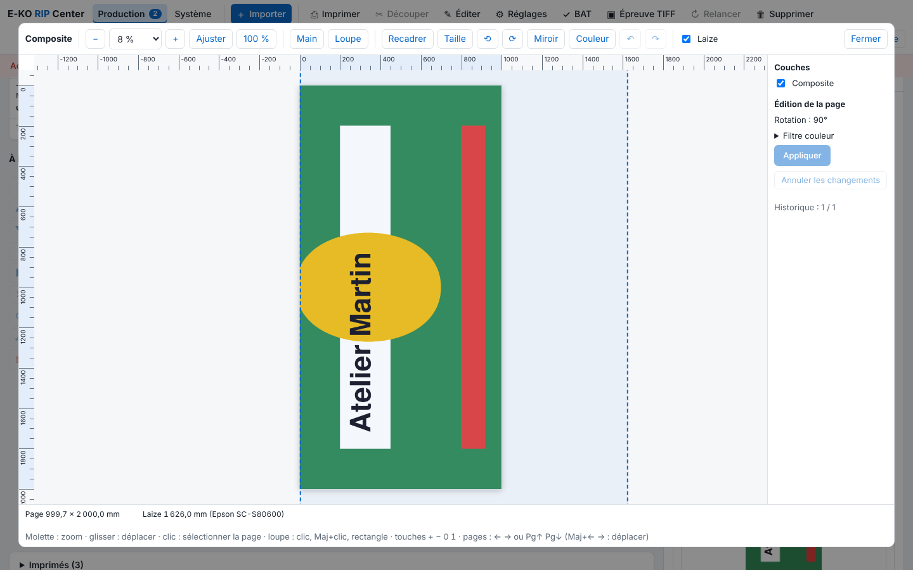

The viewer opens a job's preview at full size, to check dimensions, roll width and plates before printing. This article is for operators.

## Before you start

The job's render is finished. An **Operator** (*Opérateur*) account is enough.

## Steps

1. Click the job, then a thumbnail (composite, plate or cut) in the inspector: it opens at full size.

   
2. Zoom: mouse wheel (the point under the cursor stays fixed), **−** and **+** buttons, the percentage list (from 25 to 800%), **Fit** (*Ajuster*) or **100%** (real size on screen).
3. Choose the **Hand** tool (*Main*; drag to move) or the **Magnifier** (*Loupe*; click: zoom in; Shift+click: zoom out; draw a rectangle: zoom to that rectangle).
4. Read the rulers in mm on two edges, and at the bottom the page dimensions and the cursor position in mm.
5. Tick **Roll width** (*Laize*): the width of the media loaded in the Epson (otherwise the machine's width) is drawn. What goes beyond is in red, with the gap in mm.
6. In the **Layers** (*Couches*) panel, on the right, turn on or hide one by one the image, the cut (in magenta), the white and the silver.
7. On a multi-page job, change page in the thumbnail strip, with ← → or PgUp PgDn. The chosen view (composite, cut, plate) is kept.
8. Click the page to select it (frame and 8 handles); a click outside the page deselects it.
9. Click **Close** (*Fermer*).

## Good to know

- Keyboard: `+` `−` `0` `1` and the arrow keys.
- White and silver are the plates with the names the Epson recognises, tinted over the image. Kona marks are printed in the Black plate: no separate layer.
- The cut only overlays if it is placed like the print (no rotation or mirror from the [cut setup](rip-mettre-en-coupe-un-travail.md)).
- The viewer also lets you edit the page (see [Crop, resize or rotate a page](rip-recadrer-redimensionner-ou-tourner-une-page.md)), retouch colours (see [Retouch a job's colours with the colour filter](../rip-couleur/rip-retoucher-les-couleurs-avec-le-filtre-couleur.md)) and set panels (see [Split a page into panels and tiles](rip-couper-une-page-en-les-et-en-tuiles.md)).

## See also

- [Crop, resize or rotate a page](rip-recadrer-redimensionner-ou-tourner-une-page.md)
- [Understand ink plates and spot colour names](../rip-couleur/rip-comprendre-les-plaques-et-les-tons-directs.md)
- [Follow jobs and start printing](rip-suivre-les-travaux.md)
