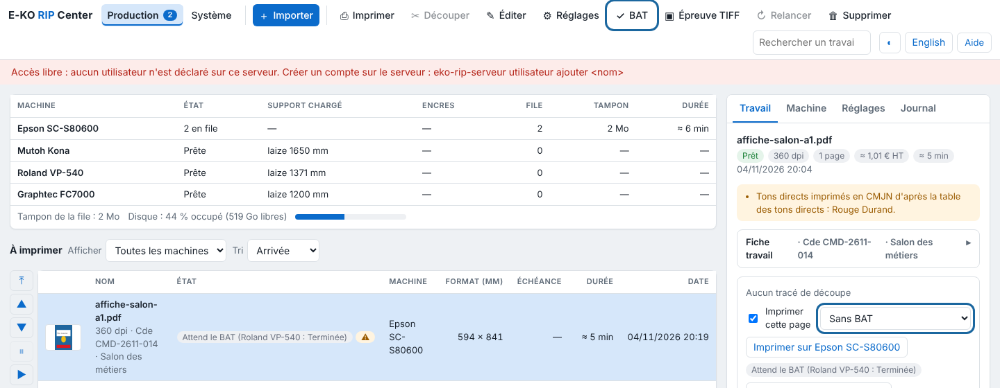
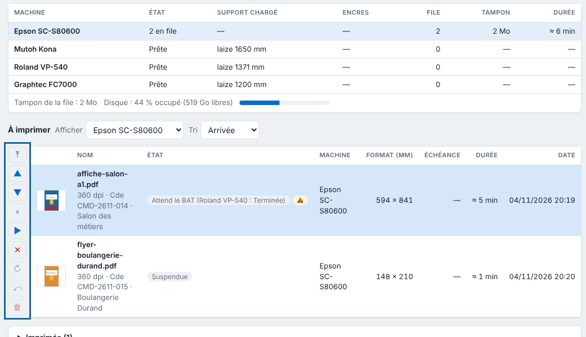

The proof is the document the customer signs before printing. This article explains how to produce it, or print a proof on another machine.

## Before you start

The job's render is finished. For a proof on another machine, the RIP must have at least two printers.

## Steps

1. Click the finished job in the table.
2. Click **Proof** (*BAT*) in the toolbar. The RIP produces an A4 landscape PDF, one page per page of the job.
3. Send this PDF to the customer. It carries the on-screen proof of the image, the cut path in magenta, the size, the settings, the alerts and a "Bon pour accord" (approved for print) box with date, name and signature.
4. For a printed proof, choose the proof machine in the inspector's list (**No proof**, **Proof on …**; *Sans BAT*, *BAT sur …*), above **Print on…**.

   
5. Click **Print on…** (*Imprimer sur…*): two outputs enter the queue. The "name-BAT" copy goes to the proof machine; the requested print is held and shows **Waiting for the proof** (*Attend le BAT*).
6. If the customer accepts, click **Resume** (*Reprendre*) on the original. If they refuse, click **Cancel** (*Annuler*).

   

## Good to know

- The proof is an A4 landscape PDF, one page per page of the job: the on-screen proof of the media profile, the cut path in magenta (not printed), the size in mm, the settings (mode, resolution, profile, white, editing, grommets), the preflight alerts and a "Bon pour accord" box (date, name and signature).
- The proof comes out in the screen's language.
- A proof on another machine is print only, on a machine different from the one requested.
- The **Proof on…** choice stays until you change it: go back to **No proof** to turn it off.
- A colour filter is mentioned on the proof, but the on-screen proof does not show it.

## See also

- [Make a TIFF proof](../rip-couleur/rip-faire-une-epreuve-tiff.md)
- [Follow jobs and start printing](rip-suivre-les-travaux.md)
- [Manage a machine's queue](rip-gerer-la-file-d-une-machine.md)
