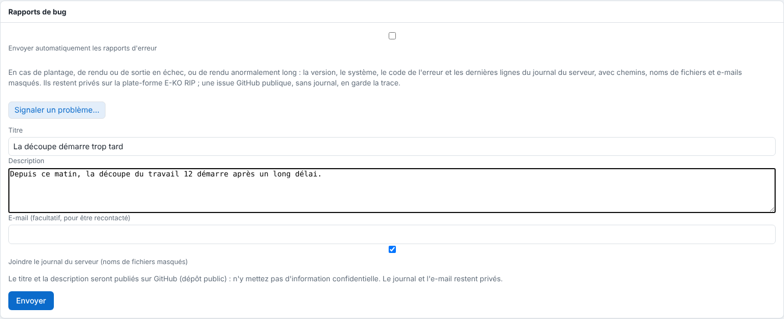

Le serveur peut envoyer de lui-même un rapport quand il plante, qu'un rendu ou une sortie échoue, ou qu'un rendu est anormalement long. Rien ne part sans votre accord.

## Avant de commencer

Il vous faut un compte administrateur. À la première ouverture de l'administration, le serveur demande s'il peut envoyer ces rapports : vous pouvez changer d'avis ensuite.

## Étapes

1. Dans le client, ouvrez **Administration…**, puis la vue **Système**.
2. Descendez à la section **Rapports de bug**.
3. Cochez ou décochez **Envoyer automatiquement les rapports d'erreur**.

   
4. Tant que personne n'a répondu oui, rien ne part.

## Bon à savoir

- Ce qui déclenche un rapport (un même code au plus une fois toutes les 6 heures) :

  | Nature | Code | Quand |
  |---|---|---|
  | `plantage` | `panique` | le serveur s'arrête sur une erreur interne (écrit avant l'arrêt, envoyé au redémarrage) |
  | `erreur` | `rendu_echoue`, `decoupe_illisible` | rendu d'un travail en échec |
  | `erreur` | `sortie_echouee` | sortie vers une machine en échec (pas les alertes de l'imprimante ni une machine éteinte) |
  | `lenteur` | `rendu_lent` | rendu de plus de 30 minutes (`EKO_RIP_LENTEUR_MIN`) |
- Le contenu : version, système, code, détail de l'erreur et les 300 dernières lignes du journal du serveur (`journalctl -u eko-rip-serveur`, que le service est autorisé à lire). Chemins, noms de fichiers, textes entre guillemets (noms de travaux ou de clients) et e-mails sont **remplacés** avant l'envoi.
- Ils restent privés sur la plate-forme E-KO RIP. Une issue GitHub publique, sans journal, en garde la trace : elle ne porte que le titre, la description, le poste, le système et la référence. Les rapports automatiques de même signature (poste, nature, code) partagent une issue, complétée d'un commentaire de compteur au plus une fois par jour.
- Tant que la plate-forme est injoignable, les rapports attendent dans `rapports/attente/` du dossier des données.
- Pour signaler vous-même un problème, voir [Signaler un problème à l'équipe](../rip-depannage/rip-signaler-un-probleme.md).
- Côté plate-forme, un rapport est gardé 90 jours ; il est limité à 20 rapports par installation et 500 en tout par jour.

## Voir aussi

- [Signaler un problème à l'équipe](../rip-depannage/rip-signaler-un-probleme.md)
- [Comprendre les statistiques anonymes](rip-comprendre-les-statistiques-anonymes.md)
- [Surveiller le service du serveur](rip-surveiller-le-service-du-serveur.md)
