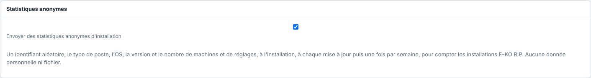

Pour savoir combien d'E-KO RIP tournent (serveurs, postes Mac, Linux, Windows, téléphones), chaque installation envoie un petit message à la plate-forme E-KO RIP : à l'installation, à chaque mise à jour, puis une fois par semaine. Il part que le serveur soit rattaché au Cloud ou non.

## Avant de commencer

Pour désactiver l'envoi sur le serveur, vous avez besoin d'un compte administrateur. Pour les clients, un accès au poste concerné.

## Étapes

1. Lisez ce qui est envoyé :

   | Champ | Exemple | Remarque |
   |---|---|---|
   | `id` | `3f9c…` (32 caractères) | tiré au hasard sur le poste, une fois ; ne dit rien du poste |
   | `type` | `serveur`, `client-mac`, `client-linux`, `client-windows`, `client-mobile` | |
   | `evenement` | `installation`, `mise_a_jour`, `hebdo` | |
   | `version` | `0.30.0` | version du logiciel |
   | `os` | `Ubuntu 26.04 LTS`, `macOS 26.1.0` | nom et version du système, rien d'autre |
   | `machines`, `reglages` | `3`, `5` | serveur seulement : nombre de machines et de réglages |
2. Pour arrêter l'envoi depuis le serveur : dans le client, ouvrez **Administration…**, vue **Système**, section **Statistiques anonymes**, puis décochez **Envoyer des statistiques anonymes d'installation**.

   
3. Sur un Mac, décochez l'envoi dans **Système › Confidentialité** ; sur un poste Linux, dans **Système › Ce poste**.
4. Pour tout arrêter d'un coup sur un poste, définissez la variable d'environnement `EKO_TELEMETRIE=0`. Sur le serveur, ajoutez-la dans `/etc/default/eko-rip-serveur` puis lancez `sudo systemctl restart eko-rip-serveur`.

## Bon à savoir

- Rien d'autre n'est envoyé : ni nom de poste, d'atelier, de machine ou d'utilisateur, ni fichier, ni travail. La plate-forme ne garde pas l'adresse IP.
- La réponse attendue est un simple accusé (`204`) ; en cas d'échec, un nouvel essai a lieu plus tard, sans rien afficher.
- Désactivé par `EKO_TELEMETRIE=0`, la case de la vue **Système** l'indique : « Désactivé sur ce serveur par EKO_TELEMETRIE=0 ».
- L'état est gardé dans `telemetrie.json` (dossier des données du serveur, dossier de configuration du client Linux) ou dans les préférences du Mac.
- Les statistiques servent à compter les installations (actives, par type, système et version) ; aucune donnée personnelle n'y figure.

## Voir aussi

- [Autoriser ou refuser l'envoi automatique des rapports d'erreur](rip-autoriser-les-rapports-d-erreur-automatiques.md)
- [Modifier les réglages avancés du serveur](rip-modifier-les-reglages-avances-du-serveur.md)
- [Se connecter au serveur depuis un poste](../rip-premiers-pas/rip-se-connecter-au-serveur.md)
