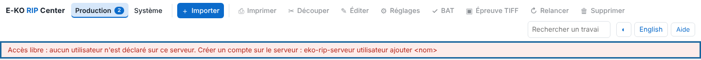
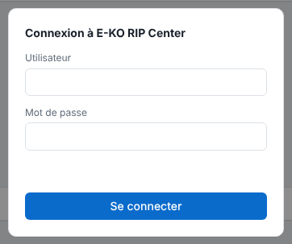
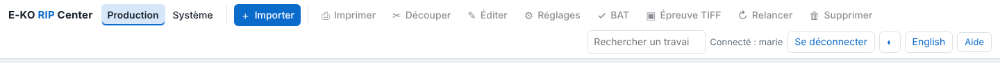

Tant qu'aucun compte n'existe, n'importe quel poste du réseau peut tout faire et l'écran le signale en rouge. Cet article s'adresse à la personne qui administre le serveur.

## Avant de commencer

Le serveur est installé (voir [Installer le serveur RIP](../rip-premiers-pas/rip-installer-le-serveur.md)). Vous avez un terminal sur le serveur et un accès `sudo`. Choisissez des mots de passe d'au moins 10 caractères.

## Étapes

1. Dans le client, ouvrez **Administration…** : tant qu'aucun compte n'existe, un bandeau rouge **Accès libre** s'affiche sous la barre d'outils.

   
2. Sur le serveur, créez le premier compte, qui sera administrateur :
   `sudo -u eko-rip env EKO_RIP_DATA=/var/lib/eko-rip eko-rip-serveur utilisateur ajouter marie`
3. Saisissez le mot de passe deux fois. Il ne s'affiche pas.
4. Créez un compte par opérateur :
   `sudo -u eko-rip env EKO_RIP_DATA=/var/lib/eko-rip eko-rip-serveur utilisateur ajouter julie operateur`
5. Rechargez **Administration…** : l'écran **Connexion à E-KO RIP Center** demande l'**Utilisateur** et le **Mot de passe**.

   
6. Connectez-vous avec chaque compte pour contrôler les droits : le bandeau rouge a disparu et l'en-tête affiche **Connecté : <nom>**.

   

## Bon à savoir

- **Administrateur** (`admin`) peut tout : machines, supports et tarifs, profils ICC, réglages enregistrés, sauvegarde, Cloud.
- **Opérateur** (`operateur`) envoie, édite, imprime, découpe, gère la file et les planches ; il voit les machines sans pouvoir les régler.
- Sans rôle précisé, le compte est administrateur s'il n'y en a encore aucun, opérateur sinon.
- Aucun redémarrage n'est nécessaire.
- Le Cloud et l'application mobile exigent des comptes.

## Voir aussi

- [Gérer les comptes du serveur](rip-gerer-les-comptes.md)
- [Se connecter au serveur depuis un poste](../rip-premiers-pas/rip-se-connecter-au-serveur.md)
- [Connexion refusée](../rip-depannage/rip-connexion-refusee.md)
- [Modifier les réglages avancés du serveur](rip-modifier-les-reglages-avances-du-serveur.md)
