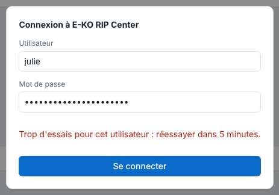

Cet article couvre la vie courante des comptes : mot de passe oublié, changement de rôle, départ d'une personne.

## Avant de commencer

Vous avez un terminal sur le serveur et un accès `sudo`.

## Étapes

1. Listez les comptes : `sudo -u eko-rip env EKO_RIP_DATA=/var/lib/eko-rip eko-rip-serveur utilisateur liste`
2. Pour un mot de passe oublié ou un changement de rôle, redéclarez le compte : `… utilisateur ajouter <nom> operateur` (ou `admin`). Le nouveau mot de passe et le rôle remplacent les anciens.
3. Pour supprimer un compte : `… utilisateur supprimer <nom>`.
4. Prévenez la personne concernée de se reconnecter si besoin.
5. Si elle a saisi cinq mots de passe faux, son nom est bloqué 5 minutes : l'écran de connexion affiche « Trop d'essais pour cet utilisateur : réessayer dans 5 minutes. » Demandez-lui de patienter.

   

## Bon à savoir

- Dans ces commandes, `…` remplace le début `sudo -u eko-rip env EKO_RIP_DATA=/var/lib/eko-rip eko-rip-serveur`.
- Supprimer un compte ferme aussitôt ses sessions.
- Cinq mots de passe faux bloquent le nom pendant 5 minutes (« Trop d'essais pour cet utilisateur : réessayer dans 5 minutes. »).
- Aucun redémarrage n'est nécessaire.
- Plus aucun administrateur : un compte déclaré sans rôle le devient.
- Les mots de passe sont gardés hachés (Argon2id) dans `utilisateurs.json` (droits 0600), jamais en clair.
- Une session dure 12 heures et est perdue au redémarrage du serveur.

## Voir aussi

- [Créer les comptes du serveur](rip-creer-les-comptes.md)
- [Connexion refusée](../rip-depannage/rip-connexion-refusee.md)
- [Sauvegarder la configuration du serveur](rip-sauvegarder-la-configuration.md)
- [Surveiller le service du serveur](rip-surveiller-le-service-du-serveur.md)
