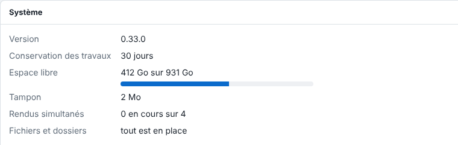

Les mises à jour du serveur se font avec celles du système. Cet article s'adresse à l'administrateur.

## Avant de commencer

Le serveur a été installé par le dépôt de paquets E-KO. Prévenez les opérateurs : un redémarrage du service coupe le rendu en cours.

## Étapes

1. Sur le serveur, ouvrez un terminal.
2. Si possible, téléchargez d'abord la sauvegarde de la configuration (voir [Sauvegarder la configuration](rip-sauvegarder-la-configuration.md)).
3. Lancez : `sudo apt update && sudo apt upgrade`.
4. Vérifiez la version : dans **Administration…**, ouvrez la vue **Système** et lisez la ligne **Version**.

   
5. Relancez les travaux passés en échec « interrompu » avec **Relancer**.

## Bon à savoir

- Les données restent en place. Avant chaque mise à jour, le paquet copie seul la configuration dans `/var/lib/eko-rip/sauvegardes/`.
- L'interface d'administration vient du serveur : les nouveautés y apparaissent dès sa mise à jour.
- Les clients se mettent à jour à part (voir [Installer le client sur Linux](../rip-premiers-pas/rip-installer-le-client-linux.md)). Un client un peu plus ancien que le serveur continue de fonctionner.
- Les nouveautés de chaque version sont dans le journal des versions : https://e-ko.rip/changelog/.
- Installé à la main avec un fichier `.deb`, le serveur se met à jour de la même façon, à la main.

## Voir aussi

- [Sauvegarder la configuration du serveur](rip-sauvegarder-la-configuration.md)
- [Remonter un serveur à partir d'une sauvegarde](rip-remonter-un-serveur.md)
- [Installer le serveur RIP](../rip-premiers-pas/rip-installer-le-serveur.md)
- Page détaillée : https://e-ko.rip/documentation/administration/
