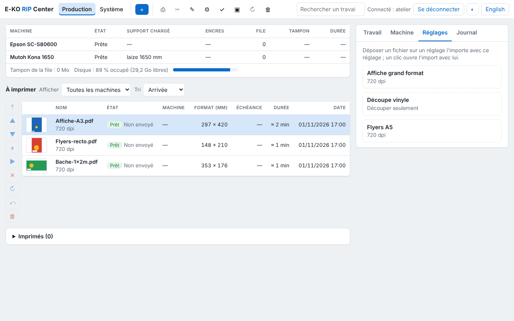

Chaque réglage enregistré a un dossier sur le serveur. En le partageant, les postes y déposent des fichiers qui partent au RIP avec ce réglage.

## Avant de commencer

Vous avez un terminal sur le serveur et un accès `sudo`. Chaque dossier se trouve sous `/var/lib/eko-rip/entrees/<réglage>/`.

## Étapes

1. Installez Samba : `sudo apt install samba`.
2. Ajoutez à la fin de `/etc/samba/smb.conf` :
   `[eko-rip]`, puis `path = /var/lib/eko-rip/entrees`, `writable = yes`, `force user = eko-rip` et `valid users = eko`, une ligne chacun.
3. Créez le mot de passe du partage : `sudo smbpasswd -a eko`.
4. Redémarrez le partage : `sudo systemctl restart smbd`.
5. Sur Mac ou Linux, ouvrez `smb://<adresse-du-serveur>/eko-rip`. Sous Windows, ouvrez `\\<adresse-du-serveur>\eko-rip`.
6. Déposez un fichier dans le dossier d'un réglage et vérifiez qu'un travail apparaît dans le client.

## Bon à savoir

- Les dossiers surveillés ne demandent pas de compte du RIP : leur accès se règle par le partage.
- Un fichier refusé est rangé dans `refuses/` avec la raison dans un fichier `.refus.txt`.
- Le nom `eko` de l'exemple est celui du compte du partage : choisissez le vôtre.

## Voir aussi

- [Déposer un fichier dans un dossier surveillé](../rip-travaux/rip-deposer-un-fichier-dans-un-dossier-surveille.md)
- [Sauvegarder la configuration du serveur](rip-sauvegarder-la-configuration.md)
- [Gérer les comptes du serveur](rip-gerer-les-comptes.md)
- [Connaître les ports réseau du serveur](../rip-premiers-pas/rip-connaitre-les-ports-reseau-du-serveur.md)
