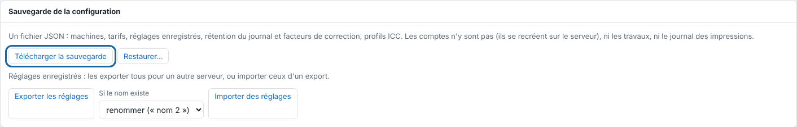

La sauvegarde de la configuration contient les machines, les supports, les tarifs, les réglages enregistrés, la découpe, les tons directs et les profils ICC.

## Avant de commencer

Il vous faut un compte administrateur. Prévoyez un endroit hors du serveur pour garder le fichier.

## Étapes

1. Dans le client, ouvrez **Administration…**.
2. Ouvrez la vue **Système**, puis descendez à la section **Sauvegarde de la configuration**.
3. Cliquez **Télécharger la sauvegarde**.

   
4. Copiez le fichier sur un autre poste ou un disque externe.
5. Refaites la sauvegarde après chaque changement de réglages.

## Bon à savoir

- Avant chaque mise à jour, le paquet copie seul la configuration dans `/var/lib/eko-rip/sauvegardes/` ; les 10 dernières sont gardées.
- Pour tout sauvegarder, comptes compris, copiez le dossier `/var/lib/eko-rip` service arrêté. Les travaux sont volumineux et se refont depuis leurs fichiers sources : la configuration et le fichier des comptes (`utilisateurs.json`) suffisent souvent.
- **Exporter les réglages** télécharge seulement les réglages enregistrés, pour les reprendre sur un autre serveur avec **Importer des réglages**.

## Voir aussi

- [Remonter un serveur à partir d'une sauvegarde](rip-remonter-un-serveur.md)
- [Mettre à jour le serveur](rip-mettre-a-jour-le-serveur.md)
- [Gérer les comptes du serveur](rip-gerer-les-comptes.md)
- Page détaillée : https://e-ko.rip/documentation/administration/
