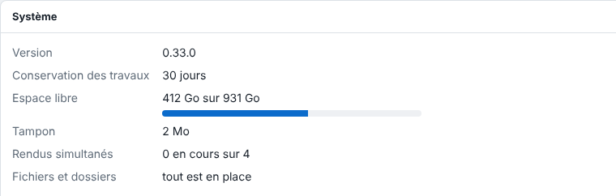

Le serveur est un service Linux nommé `eko-rip-serveur`. Cet article donne les trois commandes du quotidien et ce qu'un redémarrage change pour les travaux en cours.

## Avant de commencer

Vous avez un terminal sur le serveur (ou un accès SSH) et un accès `sudo`. Prévenez les opérateurs avant un redémarrage : il coupe le rendu en cours.

## Étapes

1. Vérifiez que le service tourne : `systemctl status eko-rip-serveur`.
2. Suivez le journal en direct : `journalctl -u eko-rip-serveur -f`. Il note chaque rendu raté et chaque sortie échouée, avec la machine, le travail, la page et la raison, ainsi que l'avertissement « aucun utilisateur déclaré » tant que l'accès est libre.
3. Redémarrez si nécessaire : `sudo systemctl restart eko-rip-serveur`.
4. Dans le client, ouvrez **Administration…** puis la vue **Système** : elle montre la version, la durée de conservation des travaux, la place libre sur le disque, le tampon et les rendus en cours.

   
5. Après un redémarrage, relancez les travaux passés en échec « interrompu » avec **Relancer**, et demandez aux utilisateurs de se reconnecter.

## Bon à savoir

- Un redémarrage coupe le rendu en cours : le travail passe en échec « interrompu » et se relance avec **Relancer**. Il ne repart pas seul.
- Les sorties en file restent dans la file ; les sessions sont perdues, chacun se reconnecte. Un redémarrage lève aussi le blocage de 5 minutes d'un nom de compte après cinq mots de passe faux.
- Le service redémarre seul avec le PC.
- Si le service ne démarre pas, lisez la fin du journal : `journalctl -u eko-rip-serveur -e`.

## Voir aussi

- [Modifier les réglages avancés du serveur](rip-modifier-les-reglages-avances-du-serveur.md)
- [Mettre à jour le serveur](rip-mettre-a-jour-le-serveur.md)
- [Résoudre un rendu en échec ou un fichier refusé](../rip-depannage/rip-un-rendu-echoue.md)
- [Reprendre après une coupure de courant](rip-reprendre-apres-une-coupure-de-courant.md)
