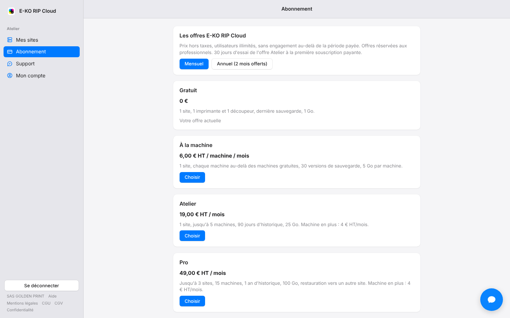

Le cloud est gratuit pour un petit atelier. Des offres payantes couvrent les ateliers plus grands.
Les prix sont hors taxes, avec un nombre d'utilisateurs illimité.

## Avant de commencer

- Comptez vos sites et vos machines. Les machines comptées sont celles que votre serveur déclare lui-même : rien à saisir.
- Les offres payantes s'adressent aux professionnels.

## Étapes

1. Repérez votre cas dans le tableau ci-dessous.
2. Ouvrez **Abonnement** sur le portail : la rubrique **Utilisation** compte vos sites, machines et sauvegardes.

   
3. Cliquez sur **Voir les offres**, choisissez **Mensuel** ou **Annuel (2 mois offerts)**, puis **Choisir** sur l'offre voulue.

   

| Offre | Prix (HT) | Sites | Machines | Sauvegardes en ligne | Stockage |
|---|---|---|---|---|---|
| Gratuit | 0 €, sans limite de durée | 1 | 1 imprimante + 1 découpeur | dernière version | 1 Go |
| À la machine | 6 € / mois par machine en plus des machines gratuites | 1 | à la demande | 30 versions | 5 Go par machine |
| Atelier | 19 € / mois | 1 | jusqu'à 5 (+4 € / mois par machine en plus) | 90 jours | 25 Go |
| Pro | 49 € / mois | 3 | jusqu'à 15 (+4 € / mois par machine en plus) | 1 an, restauration vers un autre site | 100 Go |
| Entreprise | sur devis | | | | |

## Bon à savoir

- **Abonnement annuel** : 10 mois payés pour 12 mois de service.
- **Essai** : si votre première souscription payante est l'offre Atelier, vous avez 30 jours d'essai, sans facture avant la fin. Une carte est seulement vérifiée, sans débit. L'essai n'est offert qu'une fois par compte.
- **Entreprise** : pour un besoin plus large, écrivez à contact@e-ko.rip.
- Comptez les machines avec [Comprendre les machines comptées dans l'offre](rip-cloud-comprendre-les-machines-comptees.md).
- Les conditions complètes sont dans les [CGV](https://platform.e-ko.rip/cgv).

## Voir aussi

- [Souscrire une offre](rip-cloud-souscrire-une-offre.md)
- [Profiter des 30 jours d'essai de l'offre Atelier](rip-cloud-essai-atelier.md)
- [Quand le parc dépasse l'offre](rip-cloud-parc-depasse-l-offre.md)
