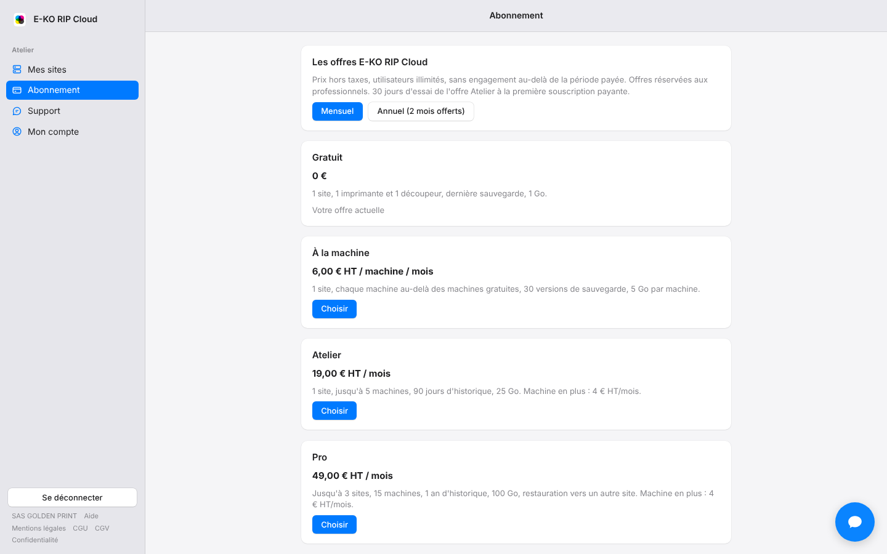

Vous souscrivez une offre payante directement dans la page, sans la quitter.
Comptez quelques minutes.

## Avant de commencer

- Choisissez l'offre et la périodicité (mensuelle ou annuelle).
- Préparez le SIREN ou SIRET, l'e-mail de facturation et un téléphone mobile.
- Pour le prélèvement SEPA, ayez l'IBAN sous la main.

## Étapes

1. Ouvrez **Abonnement**, puis **Voir les offres**.
2. Choisissez **Mensuel** ou **Annuel (2 mois offerts)**, puis cliquez sur **Choisir** sous l'offre voulue.

   
3. Renseignez l'entreprise : le SIREN ou le SIRET remplit la raison sociale et l'adresse.
4. Ajoutez le contact, l'e-mail de facturation, le téléphone et, si besoin, un numéro de bon de commande.
5. Saisissez un code dans **Code promo ou partenaire** si vous en avez un. Ses conditions s'affichent.
6. Cochez l'acceptation des CGV.
7. Choisissez **Carte bancaire** : saisissez la carte dans le champ sécurisé et confirmez auprès de la banque si elle le demande (3-D Secure).
8. Ou choisissez **Prélèvement SEPA** : saisissez l'IBAN, puis signez le mandat avec le code reçu par SMS.

## Bon à savoir

- Pour le téléphone, choisissez d'abord le pays, puis saisissez le numéro comme d'habitude.
- Un e-mail confirme l'abonnement, puis chaque facture.
- L'essai de 30 jours ne concerne que la première souscription payante, si c'est l'offre Atelier.

## Voir aussi

- [Choisir une offre](rip-cloud-choisir-une-offre.md)
- [Retrouver ses factures](rip-cloud-retrouver-ses-factures.md)
- [Changer d'offre ou résilier](rip-cloud-changer-ou-resilier.md)
- [Documentation du cloud](https://e-ko.rip/documentation/cloud/)
