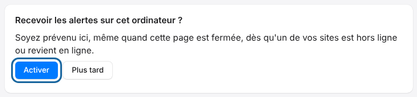
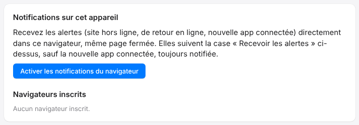

Les notifications préviennent quand un site est hors ligne, de retour en ligne, ou quand une app se connecte.
Elles suivent la case **Recevoir les alertes**.

## Avant de commencer

- Avoir un compte de la plate-forme.
- Le navigateur doit rester lancé pour recevoir les notifications, même page fermée.

## Étapes

Dans le navigateur :

1. Ouvrez **Mes sites** : la question **Recevoir les alertes sur cet ordinateur ?** apparaît après la première connexion.
2. Cliquez sur **Activer**.
3. Autorisez les notifications quand le navigateur le demande.

   

Si vous avez choisi **Plus tard** :

1. Ouvrez **Mon compte**.
2. Dans **Notifications sur cet appareil**, cliquez sur **Activer les notifications du navigateur**.

   

## Bon à savoir

- Le bandeau **Recevoir les alertes sur cet ordinateur ?** n'apparaît que si le navigateur gère les notifications et que le choix n'a pas été fait. Une fois **Activer** ou **Plus tard** cliqué, il ne revient plus : utilisez alors **Mon compte**.
- Pour arrêter sur un navigateur, voir [Arrêter les notifications d'un navigateur](rip-cloud-retirer-un-navigateur.md).
- Si le navigateur affiche « Les notifications sont bloquées pour ce site », autorisez-les dans ses réglages, puis rechargez la page.
- Si le navigateur ne gère pas les notifications, la carte affiche « Ce navigateur ne gère pas les notifications. »
- Dix navigateurs au plus peuvent être inscrits par compte.
- Les apps Mac, Linux et mobile demandent l'autorisation juste après la première connexion au cloud. Si vous l'avez refusée, rétablissez-la dans les réglages du système ou du téléphone.

## Voir aussi

- [Comprendre les notifications du cloud](rip-cloud-comprendre-les-notifications.md)
- [Choisir les e-mails reçus](rip-cloud-choisir-les-emails.md)
- [Connecter une app au cloud](../rip-cloud-premiers-pas/rip-cloud-connecter-une-app.md)
