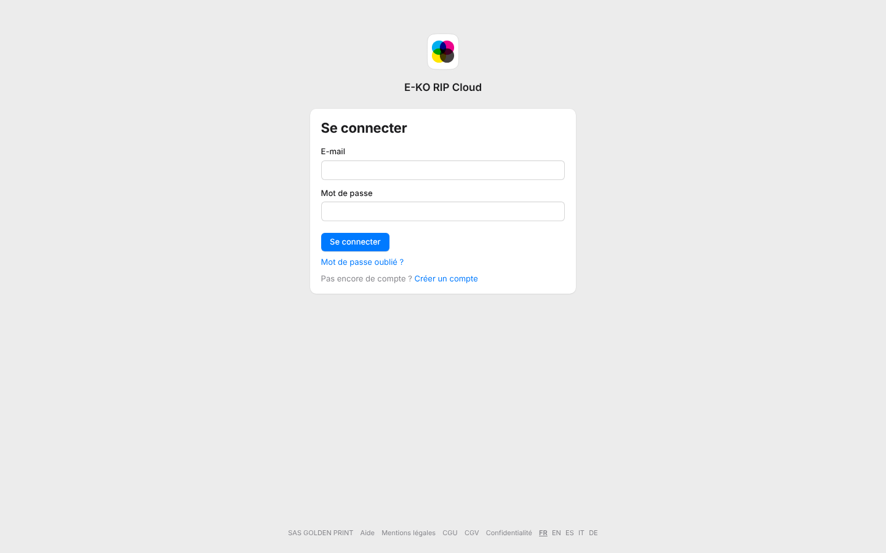
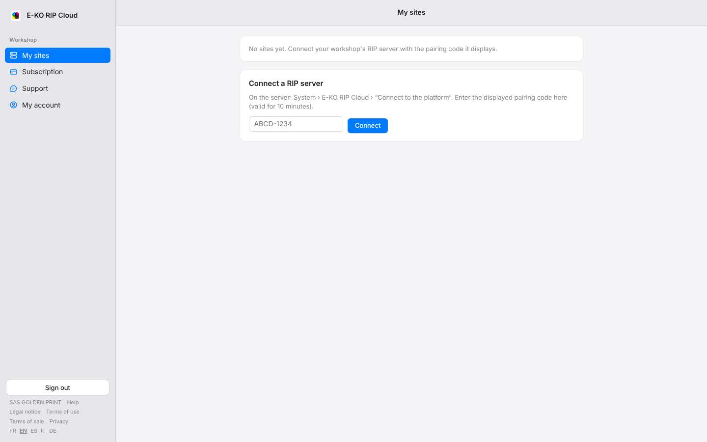

Le portail du cloud existe en cinq langues : français, anglais, espagnol, italien et allemand.
La langue choisie vaut pour les pages et, une fois connecté, pour les e-mails de la plate-forme.

## Avant de commencer

- Aucun compte n'est nécessaire pour changer la langue des pages publiques (accueil, connexion, offres).
- Au premier passage, le portail suit la langue du navigateur ; si elle n'est pas proposée, il s'affiche en anglais.

## Étapes

1. Descendez au pied de n'importe quelle page du portail. Sur ordinateur, une fois connecté, les liens sont en bas de la barre latérale.
2. Cliquez sur le code de la langue voulue : **FR**, **EN**, **ES**, **IT** ou **DE**.

   

3. La page se recharge dans la langue choisie ; son code apparaît en gras et souligné.

   

## Bon à savoir

- Le choix est retenu sur ce navigateur pendant un an. Sur un autre ordinateur ou un autre navigateur, refaites-le une fois.
- Les e-mails suivent la dernière langue choisie en étant connecté. Un compte créé dans une autre langue que le français reçoit ses e-mails dans cette langue dès l'inscription.
- Les conditions générales, les mentions légales et la politique de confidentialité restent en français, seule version qui fait foi : une phrase le rappelle en tête de ces pages.
- La bulle de discussion du support s'affiche dans la même langue que le portail.
- Les noms de vos sites, de vos machines et les messages échangés avec le support ne sont jamais traduits.

## Voir aussi

- [Consulter et gérer son compte](rip-cloud-gerer-son-compte.md)
- [Choisir les e-mails reçus de la plate-forme](rip-cloud-choisir-les-emails.md)
- [Consulter la liste des e-mails de la plate-forme](rip-cloud-comprendre-les-emails.md)
