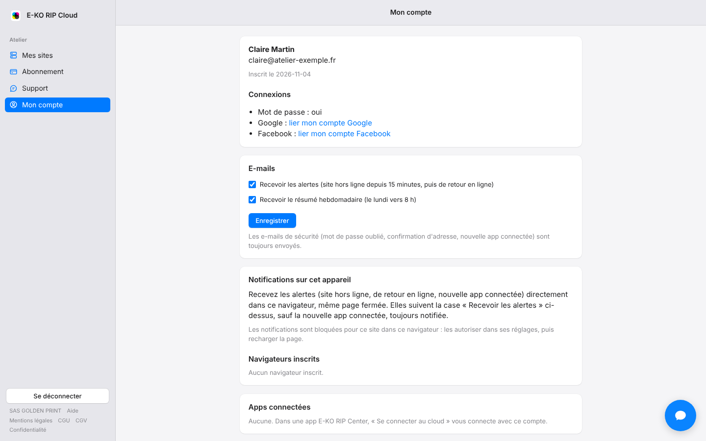

La plate-forme vous écrit quand un site est hors ligne et vous envoie un résumé chaque semaine.
Vous choisissez ce que vous recevez.

## Avant de commencer

- Les alertes concernent les propriétaires et les administrateurs du site.
- Rien n'est à configurer côté messagerie. Les messages viennent de **E-KO RIP Cloud**. Ne leur répondez pas.

## Étapes

1. Ouvrez **Mon compte** sur le portail.
2. Cochez ou décochez **Recevoir les alertes**.
3. Cochez ou décochez **Recevoir le résumé hebdomadaire**.
4. Cliquez sur **Enregistrer**.

   

## Bon à savoir

- Les deux cases sont cochées par défaut.
- Une alerte « hors ligne » part quand le serveur est injoignable depuis 15 minutes, au plus une fois par heure et par site. Un e-mail de retour en ligne suit.
- Le résumé arrive chaque lundi vers 8 h : coupures, durée hors ligne, plus longue coupure, alertes et apps connectées.
- L'e-mail « nouvelle app connectée » est toujours envoyé : c'est une mesure de sécurité.

## Voir aussi

- [Activer les notifications](rip-cloud-activer-les-notifications.md)
- [Le site est hors ligne](../rip-cloud-depannage/rip-cloud-site-hors-ligne.md)
- [Je ne reçois pas les e-mails](../rip-cloud-depannage/rip-cloud-emails-non-recus.md)
- [Documentation du cloud](https://e-ko.rip/documentation/cloud/)
