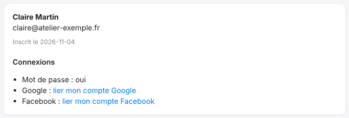
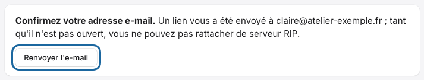

La page **Mon compte** est le tableau de bord de votre compte de la plate-forme.
Vous y retrouvez tous les réglages qui vous concernent.

## Avant de commencer

- Connectez-vous au portail.
- Ne confondez pas ce compte avec un compte du serveur RIP : ce dernier se gère sur le serveur (voir [Gérer les comptes du serveur](../rip-administration/rip-gerer-les-comptes.md)).

## Étapes

1. Ouvrez **Mon compte** dans le menu à gauche.
2. Dans la première carte, lisez votre nom, votre adresse e-mail et la date d'inscription. Sous **Connexions**, vérifiez comment vous vous connectez : **Mot de passe**, **Google**, **Facebook**.

   
3. Pour ajouter une connexion, cliquez sur **lier mon compte Google** ou **lier mon compte Facebook**, puis suivez les écrans du fournisseur.
4. Dans la carte **E-mails**, réglez les alertes et le résumé. Voir [Choisir les e-mails reçus](rip-cloud-choisir-les-emails.md).
5. Dans la carte **Notifications sur cet appareil**, activez les notifications du navigateur. Voir [Activer les notifications du cloud](rip-cloud-activer-les-notifications.md).
6. Dans **Apps connectées**, retrouvez les appareils reliés à votre compte. Voir [Déconnecter les apps du cloud](rip-cloud-deconnecter-les-apps.md).
7. En bas de page, la rubrique **Supprimer mon compte** efface le compte. Voir [Supprimer son compte](rip-cloud-supprimer-son-compte.md).

## Bon à savoir

- Si la page propose **Google** ou **Facebook** à l'inscription, les mêmes boutons servent à se connecter sans mot de passe.
- Un e-mail déjà inscrit n'est lié à Google que si Google a vérifié l'adresse. Il n'est jamais lié à Facebook sans connexion préalable : la liaison se fait ici, depuis **Mon compte**.
- Une adresse e-mail non confirmée est signalée par un bandeau en haut de page.

  
- Pour changer de mot de passe, utilisez [Mot de passe oublié](rip-cloud-mot-de-passe-oublie.md) : le nouveau mot de passe ferme toutes les sessions.
- Le propriétaire d'un site est le compte qui l'a rattaché. Voir [Comprendre les rôles sur un site](rip-cloud-roles-sur-un-site.md).

## Voir aussi

- [Découvrir le portail E-KO RIP Cloud](../rip-cloud-premiers-pas/rip-cloud-decouvrir-le-portail.md)
- [Choisir les e-mails reçus](rip-cloud-choisir-les-emails.md)
- [Supprimer son compte](rip-cloud-supprimer-son-compte.md)
