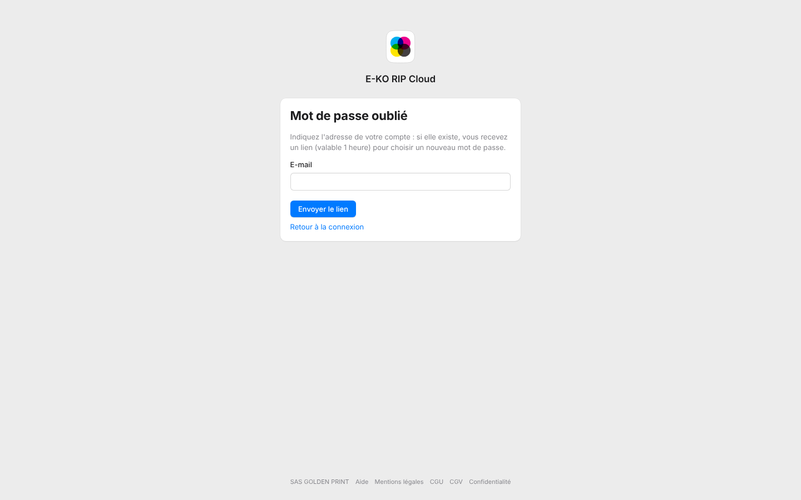

Si vous avez oublié le mot de passe de votre compte de la plate-forme, un lien vous permet d'en choisir un nouveau.

## Avant de commencer

- Ayez accès à la boîte e-mail du compte.
- Le lien est valable 1 heure et ne sert qu'une fois.

## Étapes

1. Sur la page de connexion, cliquez sur **Mot de passe oublié ?**.
2. Saisissez l'adresse du compte dans **E-mail**, puis cliquez sur **Envoyer le lien**.

   
3. Ouvrez l'e-mail reçu et cliquez sur le lien dans l'heure.
4. Choisissez un nouveau mot de passe.

## Bon à savoir

- La page répond de la même façon que l'adresse existe ou non, par sécurité.
- Le nouveau mot de passe ferme toutes les sessions du compte et déconnecte ses apps.
- Après 5 échecs de connexion, le mot de passe est bloqué 5 minutes.
- Un mot de passe de compte du serveur RIP se gère sur le serveur, pas sur la plate-forme.

## Voir aussi

- [Déconnecter les apps du cloud](rip-cloud-deconnecter-les-apps.md)
- [Je ne reçois pas les e-mails](../rip-cloud-depannage/rip-cloud-emails-non-recus.md)
- [Documentation du cloud](https://e-ko.rip/documentation/cloud/)
