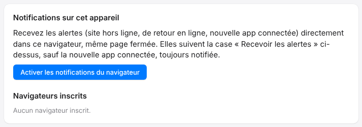

Si vous ne voulez plus recevoir les alertes sur un ordinateur, retirez son navigateur de la liste.
Les autres appareils ne sont pas touchés.

## Avant de commencer

- Connectez-vous au portail depuis n'importe quel appareil.
- Vous pouvez inscrire jusqu'à dix navigateurs par compte : retirer ceux que vous n'utilisez plus en libère.

## Étapes

1. Ouvrez **Mon compte**.
2. Repérez la carte **Notifications sur cet appareil**, puis la liste **Navigateurs inscrits**.
3. Cliquez sur **Retirer** à côté du navigateur à arrêter.

   

## Bon à savoir

- Retirer un navigateur n'efface pas l'autorisation du navigateur ; pour la couper aussi, utilisez les réglages du navigateur.
- Pour ne plus recevoir aucune alerte, décochez aussi **Recevoir les alertes**. Voir [Choisir les e-mails reçus](rip-cloud-choisir-les-emails.md).
- Pour réactiver plus tard, cliquez sur **Activer les notifications du navigateur** : voir [Activer les notifications du cloud](rip-cloud-activer-les-notifications.md).
- La notification **nouvelle app connectée** reste toujours envoyée, par sécurité.

## Voir aussi

- [Comprendre les notifications du cloud](rip-cloud-comprendre-les-notifications.md)
- [Activer les notifications du cloud](rip-cloud-activer-les-notifications.md)
- [Consulter et gérer son compte](rip-cloud-gerer-son-compte.md)
